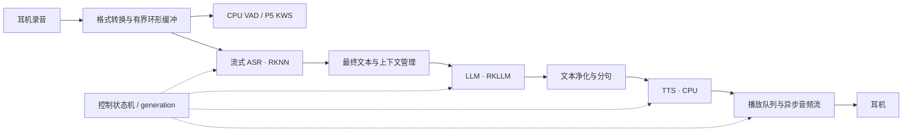

# RK3588 原生语音引擎执行计划

版本：1.45 · 更新日期：2026-10-22（Asia/Shanghai；既有历史记录日期保留）

当前阶段：**P0/M0、P1、P2、P3-01 已完成，共 12/19 项任务。P3/A07 复用原 20 条自然人声，20/20 文件流程完成，ASR 18/20、中文 CER 1.41%，LLM 内容 18/20 达到原门槛；首轮 16/20 失败和修正后残留问题保留。通用能力提示调整后，原 A04 二十问三批各 19/20。下一项为 P4-01 实时状态机与设备接入，完整 A08/A10 仍待完成。P2-04 的 5 分钟/至少 5 轮及 A01 的 60 s 用户口径不变，原 10 分钟待办保持删除；模型/SDK 及原 P0 verified 范围不扩写。详见[文件链路验收](docs/environment.md#53-p3-01-完整文件链路与-a07-验收)。**

2026-10-21 已完成 Windows 参考源码审阅并归档[参考项目总结](doc/voicenpu-reference-review.md)。四项建议已纳入 §4.5、任务表和 §9；本轮已完成模型模块及局部文件验证，主引擎接入按P4继续；该次参考审阅本身未改变模型状态，后续 P0 收尾见下文。

本文件是实施入口。环境证据见 [environment.md](docs/environment.md)，验收用例见 [ACCEPTANCE.md](docs/ACCEPTANCE.md)，问题与修订依据见 [PLAN_REVIEW.md](docs/PLAN_REVIEW.md)。[2026-10-14 原计划](docs/archive/EXECUTION_PLAN_2026-10-14.md)仅作历史留存。

## 1. 已确认条件与当前结论

目标：在香橙派 5 上运行离线语音助手，完成“触发 → 听懂 → 本地回答 → 播报”，后续加入唤醒、连续对话与打断。借鉴 voicenpu_engine 的模块划分，自建适配现有系统的工程。

| 条件 | 对实施的影响 |
|---|---|
| Orange Pi 5 / RK3588S，当前官方 Ubuntu 22.04.5 / BSP 6.1.99 | 保留板端原生 C++17/CMake；恢复结果见[当前环境](docs/environment.md#26-官方-jammy-系统网络时间与构建依赖恢复) |
| RKNPU 驱动 0.9.8，设备绑定厂商 RKNPU | 固定 RKNN 2.3.2 / RKLLM 1.3.0；P0-02 配套核查及 P0-04 SDK 最小基线完成，完整应用验收另行保留 |
| 蓝牙连接、耳机同时录放基线已由用户确认完成 | 不重做 B01；P1-02 使用[已记录的设备参数](docs/environment.md)验收新程序 |
| 基础依赖、P1 工程/音频/材料交付与板端 Git 工作方式已建立 | 按依赖推进 P2；日常操作见 [README](README.md#版本管理约定) |

用户已保留官方 Ubuntu 22.04.5 / BSP 6.1.99，继续使用蓝牙耳机、独立 C++17 / CMake。电脑使用现有 Windows + SSH；Windows Codex 可按迁移文档远程配置开发板，代码、文档及日常 Git 操作仍统一在板端工程目录进行，Windows 本地副本用于阅读交接。程序在开发板原生编译；模型优先取得配套预转换产物，**不使用 WSL，不安排其安装**。首期不引入 ROS、容器、摄像头、联网问答、工具调用或声纹识别。模型与词典备齐后，核心对话不依赖网络。中文优先，兼顾数字、日期和少量英文。

当前结论依据的盘点、用户确认与验证集中在[环境记录](docs/environment.md)。准备与探针见 §35/36，历史 P0/调优见 §41/42，P0/M0 的关闭结论以[§43](docs/environment.md#43-p0-收尾与首个已验证组合)为准，当前 P2 适配结果见[§48](docs/environment.md#48-p2-模型适配端点与流式合成)，后续 A03 范围调整见[§49](docs/environment.md#49-a03-自然人声正式验收范围)。四模型的 verified 仅覆盖 P0/M0；合成工程集不代表自然语音独立准确率，历史音频短测和集成失败保持原记录。

前一文件探针阶段的联合 Release 构建、15 项非音频 CTest 及两个探针短测通过，当时的音频集成失败未计入通过数。2026-10-22 已完成本次 P1 修复后的默认/联合 Release 构建和包含音频集成的完整回归，详见[§44](docs/environment.md#44-p1-自动化回归与固定集校验加固)。构建、CTest、模型验证与性能采样共用运行锁；性能采样时不并行编译或大文件校验，不因纯文档更新重复程序测试。

## 2. 里程碑与范围

| 里程碑 | 用户可用行为 | 必须通过 | 暂不要求 |
|---|---|---|---|
| M0 技术可行 | 选定的 RKNN 和 RKLLM 组合在本板分别推理成功 | P0-04；版本及模型可追溯 | 完整语音交互 |
| M1 按键 MVP | 通过终端命令开始/结束录音，自动端点，识别后简短回答并播报；随时取消；可清空会话 | P4-02；验收 A01～A10 | 语音唤醒、边播边说 |
| M2 连续对话 | 唤醒进入对话窗口，支持语音打断，避免自身播报反复触发 | P5；A11、A12 | 多人远场、无限距离或复杂噪声环境 |
| M3 可部署版本 | 离线启动、设备恢复、日志限额、可回退、长稳运行 | P7；A13、A14 | ROS 集成和其他产品形态 |

**M0 当前状态：已完成。** 2026-10-21 冻结的[首个组合](output/runs/p0-r-closeout-20261021-161053/verified-combination.json)覆盖上表原定义的分别推理和发布产物追溯，不扩展为完整语音交互；后续验收条件不变。

M1 的“按键”先实现为 SSH/本地终端的行命令：`start`、`stop`、`cancel`、`new-session`、`quit`。耳机媒体键和 GPIO 按钮作为后续输入适配，不作为 MVP 前置条件。

P1-01 当前提供的 [mock 控制入口](README.md#终端控制与-jsonl-日志)用于无硬件接口与状态回归，不能替代 M1 验收。

验收中的崩溃、串音、无界队列、错误设备选择属于硬性失败。性能数值是本项目的初始目标，P2/P3 用实测提出调整，写明原因并由项目负责人确认后更新；不得在报告中把未达标直接改写为通过。

## 3. 技术方案与兼容性关口

### 3.1 组件选择

| 组件 | 第一实施选择 | 接入约定 |
|---|---|---|
| 录放 | PipeWire 的 PulseAudio 兼容服务 + `libpulse` 异步 API | 一个连接管理事件循环；输入输出分流；禁止在音频回调中推理或写磁盘 |
| 格式与文件 | `libsamplerate` 重采样，`libsndfile` 读写测试 WAV | 测试文件用 16 kHz、单声道、PCM S16LE；内部帧用 float32 并显式标记幅度尺度 |
| VAD | Silero VAD，经 sherpa-onnx / ONNX Runtime 在 CPU 执行 | 和 TTS/KWS 尽量共用一套固定版本的 sherpa-onnx；按模型要求聚帧 |
| ASR | Rockchip Zipformer 中英模型，encoder / decoder / joiner，RKNN FP16 起步 | 同版本 tokens、特征提取参数和缓存形状配套；先复现官方 WAV，再改成增量接口 |
| LLM | Qwen3.5-2B，RKLLM，文本输入，W8A8 起步 | 2048 总上下文、最多 128 输出 tokens；禁用思考模式；不加载视觉编码器 |
| TTS | sherpa-onnx `vits-melo-tts-zh_en`，CPU，单说话人 | 作为第一测试声音；模型、tokens、lexicon、dict、数字/日期 FST 一起收集；输出再适配耳机采样率 |
| KWS | sherpa-onnx 中文小模型，P5 再加载 | 第一候选 `sherpa-onnx-kws-zipformer-wenetspeech-3.3M-2024-01-01`；关键词必须按模型 token 规则编码 |
| 编排 | 单一控制状态机 + 模型工作线程 + 有界队列 | 所有异步事件携带 session/generation/sequence；统一取消与超时 |
| 配置、日志 | yaml-cpp、nlohmann-json，YAML / JSONL | 启动时校验；默认不保存原始录音或完整对话内容 |

TTS 官方资料列出的 163 MB 是单个模型文件，不是完整包或运行内存；其输出为 44.1 kHz，英文发音受词典覆盖影响。只把它当待测候选，不预先保证语速和声音质量。[TTS 模型资料](https://k2-fsa.github.io/sherpa/onnx/tts/pretrained_models/vits.html)

### 3.2 SDK 选择规则

| 路线 | 本轮确认的资料 | 首轮行动 | 禁止提前认定的结论 |
|---|---|---|---|
| Qwen3.5 | 固定 RKLLM 1.3.0 英文手册直接要求配套库/头文件、GCC ≥10.2、RKNPU 0.9.8 | 当前厂商驱动、ABI、私有 runtime 和官方示例已核对；P0-02 完成 | SDK 配套通过不等于模型来源完整或应用验收通过 |
| Qwen3（历史备选） | RKLLM 1.2.1 起加入 Qwen3 支持 | 本轮不准备；仅在用户明确变更目标后评估 | 更小或更旧的模型不自动解决驱动兼容问题 |
| Zipformer | 固定 Model Zoo v2.3.2 的 commit、Toolkit2/runtime 2.3.2、RK3588 FP16 三模型和 C++ 文件示例均有证据 | 复用官方 WAV 连续 5/5 匹配；版本、转换及实际加载路径已登记 | 官方单样本通过不替代 A03 固定集质量或同进程共驻 |

依据：[RKLLM 变更记录](https://github.com/airockchip/rknn-llm/blob/main/CHANGELOG.md)、[Model Zoo 版本依赖表](https://github.com/airockchip/rknn_model_zoo#environment-dependencies)。主线会变化，下载时固定 tag/commit 和 SHA-256。本轮按用户要求固定并安装 RKNN runtime 2.3.2 / RKLLM runtime 1.3.0，具体提交与哈希见[兼容性版本锁](docs/compatibility.md#指定-runtime-版本锁2026-10-20)；模型和例程仍须分别固定及验证。

驱动适配须针对实际系统内核及接口完成，不能只替换用户态 `.so`。旧系统内置驱动的源码补丁仅通过目标文件编译预检查，完整自编译及启动未验证；预编译路线完成范围见下段。用户后续已改选并保留官方 Jammy 6.1.99，网络、时间与构建依赖已按明确授权配置；本轮范围以当前环境记录为准。官方条款、版本锁和边界集中见 [兼容性依据](docs/compatibility.md#rknpu-098-升级评估)。

内置驱动需要更新其所处的内核镜像，不等于必须在本板自行编译。此前镜像提取路线已完成[官方 BSP 6.1.99 / RKNPU 0.9.8 核验和候选打包](docs/compatibility.md#官方-bsp-6199-离线核验与候选包)，第一阶段并存安装及本机 initramfs 已完成，见[环境记录 §23](docs/environment.md#23-第一阶段授权与安装执行)；候选从未启动。整镜像迁移后已实测运行官方 Jammy 6.1.99 / RKNPU 0.9.8，不在新镜像复用旧内核脚本。此前官方 26.04 / Linux 6.18.49 的 Rocket 配置不能直接证明满足当前 SDK，须核验用户最终镜像的实际驱动。用户未改变模型目标；本轮没有执行重装或授权新的驱动混装。

**P0-04 的执行顺序：**

1. P0-02 已按原条件完成：0.9.8 / 2.3.2 / 1.3.0 固定版本、官方例程、配套头文件、ABI 和实际加载证据齐备，见[兼容性闭环](docs/compatibility.md#p0-02-配套闭环复核2026-10-21)。模型来源和 M0 由 P0-03/04 单独完成并记录限定范围。备份与回退仍见环境记录 §30。
2. 直接准备 Qwen3.5-2B / RK3588 / W8A8 文本模型，不下载或验证 0.8B，不自行更换目标。现有社区产物的固定 revision、完整哈希和 loader 生成版本已确认；实际原始权重 revision、转换命令/参数、完整校准输入及 embedding 生成依据尚未披露。公开 metadata 的 revision 不冒充实际转换输入；确需转换时登记资源缺口，不自动建立其他电脑环境。
3. 复用固定 1.3.0 官方最小示例，在私有副本加入观测并板端原生编译，记录实际加载 `.so`、哈希、模型元数据及版本日志。系统 runtime 是此前按用户授权安装的版本，本轮未更换系统库或头文件，安装与回退记录见[环境记录 §30](docs/environment.md#30-npu-runtime-指定版本更新2026-10-20)。
4. Zipformer 官方 WAV 5/5、CPU VAD/TTS 和 R 固定十问两批 10/10 的有效证据复用；本轮只补 R 一次生成中取消和同句柄恢复，2 s 原门槛内通过。原题、评分、模型/SDK 及历史失败不变，未把固定集结果外推为通用质量或完整 A04/A08；见[收尾汇总](docs/environment.md#43-p0-收尾与首个已验证组合)。
5. 已按 P0-04 的 SDK 基线条件冻结首个 verified 组合，清单保留原 preparation_run_id、本次 run_id 和 verification_scope。用户接受社区预转换产物，明确不再追查 LLM 转换步骤；实际历史 recipe 未知与可追溯发布产物分开记录，不冒充已补齐。完整应用、共驻、发布资格和历史转换复现均不在本次 verified 范围。

**兼容失败分支：**本轮固定 RKNPU 0.9.8 / RKNN 2.3.2 / RKLLM 1.3.0 及所选模型，不自动升级、降级或换模型绕过失败。缺产物或运行失败时记录原因、资源和下一步，M0 保持未通过；不把 CPU 推理当作 NPU 验证。独立工程任务可继续，目标变更由用户明确指定。

当前目标固定为 Qwen3.5-2B；缺少配套产物时保留未完成状态，不自行用 0.8B、Qwen3-1.7B 或其他模型替代。模型目标变更由用户明确指定。

ASR 与 LLM 的库可能同时依赖 RKNN 公共符号。P2-04 已在固定版本下完成四模型同进程共存和实际库加载验证，见[共驻证据](docs/environment.md#51-p2-04-四模型共驻与五分钟验收)，本次固定四模型文件负载无需 LLM 进程隔离。后续更换模型/runtime 或加入 KWS 时需重验；若出现不可消除的冲突，再使用有界 IPC 隔离并更新架构、内存预算及验收，不随机调整库搜索顺序掩盖问题。

## 4. 实现约定

### 4.1 音频、ASR 与端点

- 系统级蓝牙连接和录放基线已完成。新程序接入时枚举并保存真实 source/sink；排除 monitor，禁止丢失耳机后自动播到 HDMI 或板载扬声器。
- 保持用户验证过的双向 profile；设备名比临时数字 ID 稳定，但也需用设备属性核验。断开或 profile 变化时关闭旧流、清空残帧及重采样状态，再按配置重新匹配。
- 应用传输帧默认 20 ms；VAD 和 ASR 各自累积到模型要求的窗口，不能直接把 20 ms 当作模型输入长度。
- 内部统一单声道 16 kHz float32；VAD 使用归一化尺度，ASR adapter 按所固定例程的幅度、fbank、帧移和填充要求转换，以同一 WAV 对齐结果。麦克风不足 16 kHz 时重采样不恢复带宽。
- P1-02 已实现独立的异步 PulseAudio 后端及流式 DSP；末帧用有效样本数区分补零与真实音频，正常结束完成尾部转换，取消/重连丢弃旧残帧。诊断工具用法见 [README](README.md#真实音频诊断)，实机通过条件仍以 A01/A02 为准。
- ASR 接口至少包含 `reset`、`accept_audio`、`finish_input`、`partial/final`。维护跨帧 fbank、encoder 缓存、decoder 历史和末尾补帧；一轮结束、取消、设备重连时复位。
- VAD 初值：预录 500 ms、最短有效语音 200 ms、末尾静音 600 ms、等待开口最多 5 s、单次发言最多 15 s。无声超时返回等待；达到上限则结束本轮并给出长度限制事件；空识别不请求 LLM。

官方 Zipformer C++ 示例将完整音频先交给特征提取器，再按模型块推理。上述增量改造必须单独完成，不能以 WAV 示例通过代替实时流通过。[官方源码](https://github.com/airockchip/rknn_model_zoo/blob/main/examples/zipformer/cpp/rknpu2/zipformer.cc)

### 4.2 状态、调度与数据边界

主状态：`STARTING → IDLE → LISTENING → FINALIZING → RESPONDING → IDLE`。P5 开启连续对话时，正常播报结束转回带 15 s 等待窗口的 LISTENING，超时再回 IDLE。异常分支为 `CANCELLING`、`DEVICE_WAIT`、`ERROR`、`STOPPING`。`RESPONDING` 内用独立标记表示 LLM、TTS、播放是否活跃，允许三者流水工作，不将“生成中”和“播放中”建成互斥状态。

- M1 默认 ASR 和 LLM **串行占用 NPU**。录音线程始终独立运行，输出期间不自动发起 ASR/KWS 请求；`start` 会取消当前回答再开始新一轮。P5 的 CPU VAD/KWS 先检测用户，再取消 LLM，确认释放 NPU 后启动 ASR。
- 数据结构至少有 `session_id`、`generation_id`、`seq`、单调时钟时间戳；音频还带采样率、声道、样本数，文本带 `partial/final`。ASR partial 仅用于显示，final 才触发 LLM。
- 模型句柄由各自 worker 持有；控制线程发送消息，不跨线程销毁仍在推理的句柄；SDK 回调上下文存活至任务完全结束。
- 首版每模块单 worker，TTS 推理线程初值 2，VAD/KWS 初值 1；按实测控制总线程数，不默认绑核、提实时优先级或锁最高频率。

| 缓冲/队列 | 初始上限 | 满载行为 |
|---|---:|---|
| 采集环形缓冲 | 2 s，预录包含在此范围内 | 采集不阻塞；标记溢出并结束受影响轮次，不把缺帧拼成正常语句 |
| 等待处理的用户轮次 | 1 | 新 `start` 取代旧轮次，执行取消；不排队攒问题 |
| LLM 回调文本 | 8 KiB | 回调不等待 TTS；超限触发本轮受控取消并记录原因 |
| 待合成文本 | 4 段，每段最多 40 个 Unicode 字符 | 上游有界协调；无法限流时受控取消，不静默丢中间句子 |
| 待播放 PCM | 按实际采样率计，最多 2 s | TTS worker 可取消地等待；录音/控制线程不等待 |
| 单次 TTS 临时输出 | 最多 20 s 音频，一次只持有一段 | 分成小帧送入播放队列；超过上限取消并报告 |

### 4.3 取消、播报与连续会话

取消顺序：控制线程先递增 generation → 关闭旧输出入口 → 清空旧文本/PCM 队列 → 请求 LLM abort、取消 TTS → 对播放流 cork/flush → 等待模型结束确认，再允许下一次 NPU 调用。每个回调、队列入口和播放提交点均核对 generation；旧结果即使迟到也不得提交。

`rkllm_abort` 返回不等于回调已经全部结束；按固定版本 API 检查运行状态和结束事件。等待上限初值 2 s，超时进入 ERROR 并交由进程重启策略恢复，不强行释放活动句柄。新语音可先存入 2 s 环形缓冲；若恢复不及导致溢出，报告需重说，不隐瞒丢字。[RKLLM API](https://github.com/airockchip/rknn-llm/blob/main/rkllm-runtime/Linux/librkllm_api/include/rkllm.h)

播放取消使用 flush 丢弃缓冲，正常结束才 drain；两者语义不同。音频服务确认清空不代表蓝牙耳机的硬件缓冲已经静音，因此软件取消时间和实际尾音分开测量。[PulseAudio API](https://github.com/pulseaudio/pulseaudio/blob/master/src/pulse/stream.h)

LLM 输出先做跨 token 的 UTF-8 拼接和控制标记过滤，再分句。按句末标点切分，初值最短 8 字、最长 40 字；等待超过 300 ms 且已有足够文字可提前分段；EOS 时冲刷剩余短句。不要截断 UTF-8 字节、数字小数或未闭合控制标记。TTS 不播报思考内容、特殊 token 或 Markdown 控制符。

会话由应用持有，默认不与 runtime 的隐式历史重复累积。按固定 tokenizer/chat template 计算总 tokens：系统提示 + 历史 + 本轮输入 + 128 输出预算 + 64 余量 ≤ 2048；超限按完整轮次淘汰最旧历史，单条输入仍过长则拒绝并提示缩短。模板只能应用一次。结束/取消后按已验证 API 清理 KV 状态；仅把完整正常完成且播报结束的问答对加入历史，取消轮次不写入。

P5 采用可配置唤醒词，初始开发词为“你好小派”，并验证该词在候选 KWS 模型上可编码。唤醒后开放 15 s 对话等待窗口；播报结束后重新计时；无声超时回到等待唤醒。语音打断初值需持续语音 250 ms，并用 A12 验证。若自身声音误触发，则评估 AEC 的播放参考、时间对齐和延迟漂移；未通过前关闭语音打断，保留按键 MVP，不能宣称 M2 完成。

### 4.4 故障与超时初值

| 情况 | 行为 |
|---|---|
| 缺模型、哈希不符、缺词典、错误设备配置 | 启动校验失败，报告明确文件/配置；不循环下载 |
| ASR 端点后 3 s 无最终结果 | 取消本轮并复位 ASR |
| LLM 10 s 无首 token 或总生成超过 30 s | 发起取消；保留日志和原因 |
| 单段 TTS 10 s 未完成 | 取消该轮；不把失败文本留到下一轮 |
| 设备断开、profile 变化 | 取消本轮，进入 DEVICE_WAIT；按 1/2/5 s 退避发现设备；恢复后等待新触发 |
| 运行时失去响应 | 最多等待取消 2 s；受控退出；部署层在 60 s 内最多重启 3 次 |
| MemAvailable 连续 3 s 低于 1.5 GiB | 拒绝新轮次并取消/释放可回收缓存；不得依赖持续 swap 维持交互 |

### 4.5 参考项目建议的实施约定

参考来源、代码位置及限制集中维护在 [voicenpu_engine 参考总结](doc/voicenpu-reference-review.md)，本节作为后续实施要求。以下均待实现或对比验证，不表示参考程序或本工程已达到相应验收。

| 建议 | 对应任务 | 实施要求 |
|---|---|---|
| [R1 短首分句](doc/voicenpu-reference-review.md#r1-first-audio) | P2-02 / P2-03 / P3-01 | 沿用现有 UTF-8/数字保护和短句 EOS；提示词与分段阈值匹配。LLM 回调仅投递有界文本队列，TTS worker 独立消费；以同条件文件对比首可播文本、首段 PCM、完整耗时和听感 |
| [R2 常驻 LLM adapter](doc/voicenpu-reference-review.md#r2-llm-adapter) | P2-02 | 从板端已验证示例整理生命周期、模板/能力边界、预算、超时和恢复；保留 Qwen3.5 与固定 SDK。初始化/首轮/受控预热分别统计，预热不得污染会话历史 |
| [R3 原子输出提交](doc/voicenpu-reference-review.md#r3-cancel) | P2-02 / P2-03 / P4-01 | generation 检查与受控提交在同一同步边界；锁内不等待推理或设备阻塞 I/O。取消失效贯穿文本、PCM 和播放，覆盖尾回调、提交竞态及立即新会话 |
| [R4 ASR/VAD 端点接入](doc/voicenpu-reference-review.md#r4-asr-vad) | P2-01 / P4-01 | LISTENING 持续增量识别，VAD 端点收尾并复位；补无声等待、最长发言和首尾帧覆盖。识别质量独立按 A03 判断，不把结构改造当作准确率提升证据 |

验收及时间点口径继续使用 [ACCEPTANCE.md](docs/ACCEPTANCE.md)。参考项目的模型、ROS2/ALSA 前端、回调内同步合成和不完整的播放取消不直接移入；具体原因见参考总结。

## 5. 工作分解、依赖与交付

角色：**实施者**负责开发与客观证据，**用户/项目负责人**负责声音体验、答复质量和目标变更确认。所有未标记完成的任务均为待执行；文件名和命令接口是交付约定，不表示工具已经存在。

| ID | 任务与主要动作 | 依赖 | 交付与完成条件 | 状态 |
|---|---|---|---|---|
| B00 | 盘点板端、电脑及项目现状 | 无 | `docs/environment.md` 与检查证据 | 已完成 |
| B01 | 蓝牙连接与耳机同时录放基线 | 无 | 用户确认通过，不再要求重复基础测试 | 已完成（用户确认） |
| P0-01 | 初始化 Git；忽略模型/构建/音频/本机配置；安装最小板端开发依赖 | B00 | C++17、CMake、pkg-config 可用；空程序可构建；依赖版本清单 | 已完成并在新系统复核：板端克隆、依赖安装、Release、env_check 与 8 项构建范围测试通过；见[当前环境](docs/environment.md#26-官方-jammy-系统网络时间与构建依赖恢复) |
| P0-02 | 固定 SDK 候选及官方例程版本；落实兼容厂商 RKNPU 的系统方案，补全 ABI 要求 | B00 | `docs/compatibility.md`；RKLLM 路线满足官方驱动前置条件后才进入 P0-04 | 已完成：固定驱动/runtime/头文件、官方例程、ABI 与实际加载证据闭环；见[配套核查](docs/compatibility.md#p0-02-配套闭环复核2026-10-21)，模型来源和完整交付不混入 SDK 任务 |
| P0-03 | 准备目标 2B、Zipformer、Silero VAD 与 MeloTTS 配套资产；缺转换产物时记录资源需求 | P0-02 | 文件大小/哈希/来源及生成版本齐全；缺项明确记录，不自动建立电脑运行环境 | 已完成：四类资产及配套依赖的固定发布身份、大小/哈希、版本和输入契约已记录；本轮补 Melo 发布快照及 ONNX 自述 producer。按用户确认使用社区预转换产物，历史转换未知项留档，不再阻塞 P0；见[收尾与边界](docs/environment.md#43-p0-收尾与首个已验证组合) |
| P0-04 | 板端官方最小推理，按用户本轮模型范围执行 | P0-01～03 | M0 通过；冻结首个 verified 组合；A03/A04 的 SDK 基线部分 | 已完成：ASR 官方 5/5、VAD/TTS 最小证据与 R 固定十问两批 10/10 复用；R 新增主动取消 97.467 ms、清 KV 后同句柄恢复通过。已冻结限定 P0/M0 的首个 verified 组合；P0 阶段未覆盖完整 A03/A04/A08；当前状态见下方 P2 任务，P0 证据见[收尾](docs/environment.md#43-p0-收尾与首个已验证组合) |
| P1-01 | CMake 工程、配置校验、JSONL、控制命令、无硬件 mock 边界 | P0-01 | `voice_engine --check-config` 与错误退出码；可独立构建 audio/engine | 已完成并再次复核：默认/联合 Release、完整 CTest、三种独立构建、ENV_CHECK_OK 与本机配置检查通过；见[本轮回归](docs/environment.md#44-p1-自动化回归与固定集校验加固)，原始骨架证据见[§11](docs/environment.md#11-p1-01-完整工程骨架验证) |
| P1-02 | 异步录放、设备绑定、重采样与重连；使用已记录的耳机参数 | P1-01、B01 | `audio_probe`；A01/A02 通过（验收新程序） | 已完成：隔离音频自动化回归通过；按用户修订的 A01 60 s 连续录放达标，A02 三种状态重连及恢复后新轮次通过，原 10 分钟待办已删除。见[实机结果](docs/environment.md#45-p1-耳机一分钟录放与三种状态重连)与[自动化回归](docs/environment.md#44-p1-自动化回归与固定集校验加固)；历史失败记录保留 |
| P1-03 | 提前准备 20 条固定语音、参考转写、关键词和 LLM/TTS 文本用例 | P1-01 | 版本化 fixture 清单，满足验收文档的样本定义；不依赖实时引擎 | 已完成材料与人工审核：20 条自然人声按 8/5/4/3 类别冻结且试听通过；20 条合成材料审完，19 条通过，`mix_02` 发音缺陷留档，两条有句子边界试听通过。原工程集/静态用例/校验保留；自然 WAV 私有，仅清单入版本管理。同文本、单说话人限制及证据见[固定测试集](docs/file-fixtures.md)和[本轮记录](docs/environment.md#46-p1-03-自然人声与人工材料审核) |
| P2-01 | VAD / 流式 ASR adapter，缓存复位、WAV/分块一致性及 R4 端点边界 | P0-04 的 ASR 基线、P1-01、P1-03 | `asr_probe`；按自然人声正式范围通过 A03 | 已完成：ListeningAsr 单轮增量/预录/端点/收尾/复位与109项核验通过；固定自然三批18/20、CER1.41%、预热RTF P95 0.121，自然尾部全文及跨分块检查通过。用户选择旧合成失败仅作非阻塞回归；见[范围调整与验收](docs/environment.md#49-a03-自然人声正式验收范围)。P4设备/主引擎接入另行实施 |
| P2-02 | 常驻 RKLLM adapter，流式文本、模板/能力边界、上下文、预热对比、abort 与超时（R2/R3） | P0-04、P1-01、P1-03 | `llm_probe`；A04/A08 模型侧通过 | 已完成：正式常驻adapter/probe及R2/R3回归通过；P2旧提示下20问×3各20/20（P3当前提示回归各19/20）、10次加载释放、5组多轮、超长/两类超时恢复，首token前/生成中各5次取消及旧提交/新会话通过。完整A08的PCM、播放flush、耳机尾音仍属后续；见[LLM探针](docs/llm-probe.md) |
| P2-03 | TTS adapter、中文归一化、分句、首段延迟对比及播放格式转换（R1） | P0-01、P1-01、P1-03 | `tts_probe`；A05 通过；声音样本供用户听取 | 已完成模型侧交付：有界worker、R1文件对照与听感通过；中文逗号上下文修正经实际音素核对及正式A05复验通过，三批30/30、RTF P95 0.863、十条试听10/10，三次“搜索”均清楚。可选“调低”规则及历史失败单列，见[TTS复验](docs/tts-probe.md#2026-10-22-搜索修正与-a05-复验) |
| P2-04 | 所有 MVP 模型同时驻留、同进程库兼容与顺序 NPU 调度 | P2-01～03 | `coexist_probe`；A06 通过（连续运行 5 min、至少完成 5 轮）；确定是否需进程隔离 | 已完成：304.870 s / 44 轮，最小余量 4.088 GiB；固定四类库同进程运行、顺序 NPU 与有界队列通过，本次固定四模型文件负载无需 LLM 进程隔离。三次严格零换页诊断失败保留，用户确认按原无持续换页口径完整复验通过；见[本轮证据](docs/environment.md#51-p2-04-四模型共驻与五分钟验收) |
| P3-01 | 使用 P1-03 的固定语料验证文件级完整链路 | P2-04、P1-03 | `voice_file_demo`；A07；各段耗时、内存与失败样本可复查 | 已完成：原自然集20/20流程，ASR18/20、CER1.41%，LLM内容18/20；真实ASR输入、独立会话、空输入拦截及PCM/WAV关联通过。首轮16/20和当前残留内容问题保留；见[文件链路](docs/voice-file-demo.md)与[验收证据](docs/environment.md#53-p3-01-完整文件链路与-a07-验收) |
| P4-01 | 实时状态机、端点、分段播报、有界队列、原子输出提交与按键取消（R3/R4） | P1-02、P3-01 | `voice_engine`；正常、无声、超时、取消均有确定状态转移 | 待执行 |
| P4-02 | 20 轮实机交互、延迟批测及异常注入 | P4-01 | A01～A10 均通过，发布 M1；未达性能目标需明确记录 | 待执行 |
| P5-01 | CPU KWS、关键词编码、连续对话窗口 | P4-02 | A11 通过，关键词配置可修改 | 待执行 |
| P5-02 | 语音打断、迟到回调防护、回声误触发测量 | P5-01 | A12 通过；若需 AEC，完成 P6-01 后再验收 M2 | 待执行 |
| P6-01 | 根据报告优化端点/分句/线程/缓冲，必要时实验 AEC 或 NPU 并发 | P4-02；涉及语音打断时依赖 P5-02 初测 | `docs/performance.md`，同样本前后对比；优化后重跑受影响用例 | 待执行 |
| P7-01 | 固定发布目录与库路径、离线资产检查、用户服务及回退 | M1；发布 M2 时还需 P5 通过 | `docs/deployment.md`、启动/回退脚本；A13 通过 | 待执行 |
| P7-02 | 1 小时长稳、无桌面登录启动、退出登录/重启及设备恢复验收 | P7-01 | A14 通过，发布 M3，标注所含功能是 M1 还是 M2 | 待执行 |

P1 音频、P2-03 CPU TTS 可在 NPU 兼容调查期间独立推进。P2-01 文件适配以 P0-04 的 ASR 局部基线为前置，该阶段曾独立于 LLM 推进；现在 RKNN/RKLLM 分别推理及选定 R 的取消/恢复证据已满足 M0/P0-04 最小交付；后续正式适配与应用验收按各任务继续。P2-04 必须在整条链路开发前完成。首次交付 M1 不必等待 P5/P6。

按 1 名实施者初估：P0 2～4 人日，P1 2～3，P2 4～6，P3 1～2，P4 3～4，P5 3～5，P6 2～4，P7 1～2；总计 **18～30 人日**，其中 M1 工作量约 **12～19 人日**。不含模型大文件下载等待、硬件等待和内核/驱动升级专项。P0/P2 结束后依据结果重估，不给未经验证的日历承诺。

## 6. 验收入口与执行证据

完整矩阵在 [ACCEPTANCE.md](docs/ACCEPTANCE.md)。首个发布的核心要求：固定语音语料至少 18/20 条关键词全部正确；20 轮实机对话全部完成；无旧 generation 播报、无无界队列、无 OOM；模型共驻时维持 1.5 GiB 内存余量目标。

延迟分别报告“最后语音采样点 → 实际首音频”和“VAD 端点 → 首音频”，预热短回答的前者 P95 初始目标为 ≤5 s；软件提交与实际听见分别记录。时间点、声学测量、估算标记及统计口径统一遵循 [验收文档 §4](docs/ACCEPTANCE.md#4-时间点口径与统计)。

运行目录与日志格式见 [README](README.md#终端控制与-jsonl-日志)，真实音频诊断的报告见 [README](README.md#真实音频诊断)，实际结果见 [环境记录](docs/environment.md)。`audio_probe` 已输出 `run.json`、`events.jsonl` 与 `summary.json`，A01/A02 的 P1 实机审核已通过，见[实机记录](docs/environment.md#45-p1-耳机一分钟录放与三种状态重连)；工具原始报告中的 `not_run` 保留，由独立复核记录登记结论。后续模型验收继续扩展模型版本/环境/用例元数据、`metrics.jsonl` 和失败样本 ID；调试 WAV 按需开启且受配额限制。状态为 `passed / failed / blocked / not_run`，只有真实通过才勾选。用户确认的 B01 标为 `user_confirmed`，不伪造时长、采样率和测量日志。

## 7. 工程、资产与依赖管理

完整目录与文件入口见 [README 的项目目录](README.md#项目目录)，日常 Git 操作见 [版本管理约定](README.md#版本管理约定)；每次更新按 [AGENTS.md](AGENTS.md) 同步对应文件。模型使用配套预转换产物，板端不安装模型训练环境。

P1-01 已定义设备、VAD、模型绑定与资产路径、线程、token 预算、队列、超时、日志、唤醒和打断配置，并对启用模型及其声明依赖执行文件完整性校验。未启用的功能不要求取得对应资产；`--check-config` 不打开录音或执行模型。P1-02 已接入设备身份/profile 在线核验与音频队列限额，文件探针已使用对应的 VAD、ASR、TTS 参数，实时模型编排仍由后续任务执行，mock 只作为无硬件开发入口。

当前字段、校验与退出码见 [README 的配置检查](README.md#配置检查)，清单格式与路径规则见 [资产清单](README.md#资产清单)，控制命令和 JSONL 格式见 [终端控制与日志说明](README.md#终端控制与-jsonl-日志)。两份 manifest 在原文件/来源/版本基础上增加 P0 验证范围、本次证据和原准备 run_id；全部文件声明未变，复用有效大文件哈希并核对 stat、大小、路径和版本关系。当前 verified 只表示注明的 P0/M0 范围，ASSETS_OK 不代表推理或发布验收通过。

取得真实模型时，除清单必需元数据，还须补充转换命令和校准数据来源/哈希、输入输出/采样率/词表约定、实测峰值内存及推理证据。预转换模型也必须说明生成版本；来源不明的模型不作为发布资产。清单允许扩展这些记录，但通过文件校验不会自动验证其真实性或把 candidate 升为 verified。

2026-10-21 用户明确确认使用已下载的社区预转换产物，并说明无需继续追查 LLM 转换步骤。当前 P0 按可固定的发布来源、revision/asset ID、哈希、许可声明、可观察生成元数据及实际运行证据收尾；Qwen/Silero/Melo 未公开的历史转换细节仍填 unknown。此范围确认不等于历史步骤已还原，也不变更内容评分、性能/资源和后续验收标准；未知项不再作为本次 P0 阻塞或持续追查任务。发布/再分发仍不得把来源或许可边界未知写成已解决。

依赖清单同时锁定 runtime、C/C++ 头文件、sherpa-onnx、ONNX Runtime 和模型词典。板端使用程序相对 RPATH 或启动脚本的私有库路径，记录实际加载路径，禁止只换 `.so` 不换配套头文件/产物。

基础依赖及版本清单见 [环境记录](docs/environment.md)。后续安装前模拟并核对空间；音频查询工具使用现有兼容服务，不额外启用 PulseAudio 服务。ASR 的 fbank 等依赖跟随固定例程登记。

模型准备采用“Windows Codex → 现有 SSH → 板端私有目录下载、校验、编译和验证”。所有模型初始化、推理、性能采集及需要执行模型的转换检查共用 `flock -x /tmp/rk3588_voice_engine_model_validation.lock`，覆盖整个验证进程。此前 P0 专项仅 LLM 子代理执行模型，性能采样时不并行编译或大文件校验；该专项已完成授权的固定十问、一次取消、一次恢复及一次有依据的通用短答模板复核，未扩展正式 adapter、共驻、实时对话或长稳。必须同时取得生成版本、目标 `rk3588`、量化方式和配套运行库；实际转换来源缺失时明确保留。确需转换时登记 SDK、输入输出和资源要求，不自动建立 WSL、虚拟机、容器或其他电脑环境。

## 8. 资源、部署与回退

### 8.1 资源控制

以下空间表仅覆盖语音应用、开发依赖及模型资产，**不包含完整内核源码、对象文件、调试信息和内核包暂存**；内核重编译另按下文专项预算执行。

| 项目 | 板端新增空间预算 |
|---|---:|
| 开发依赖与源码 | 0.3～1.0 GiB |
| ASR/VAD/KWS 与语音 SDK | 0.5～1.5 GiB |
| 一份 Qwen3.5-2B 及 runtime | 1.8～3.5 GiB |
| 一份 TTS 与语言资产 | 0.2～0.8 GiB |
| 编译产物 | 0.5～1.5 GiB |
| 下载、解压、发布暂存 | 0.5～3.5 GiB |
| 日志及人工保存的音频 | 最多 0.5 GiB |

表内上限合计约 12.3 GiB，属未由实际模型验证的预算；额外一份完整旧模型未包含。每次下载/转换/发布前按实际文件大小计算同时存在的模型、压缩包、解压目录和回退文件；操作后预计空闲低于 3 GiB 则停止新增文件。候选权重优先留电脑；清理先列路径与用途，不删除当前模型和回退所需文件。

不能将模型磁盘大小当作运行内存：P2-04 同时采集总 RSS/PSS（可取到时）、MemAvailable、swap 变化及 NPU 分配相关指标。系统监测采样周期 1 s；记录 CPU/NPU 频率与温度，确认降频是否造成后半程延迟恶化。

当前单 run 的 [JSONL 轮转配置](README.md#配置检查)已实现，跨 run 日志总量管理与自动清理仍待部署阶段落实。人工音频共享总 500 MiB 额度，达限停止新增音频。常态不记录录音、完整 prompt/回答和私有连接凭据。

**P0-02 内核构建专项预算（2026-10-18，尚未经完整构建实测）：**

本预算仅在选定自编译路线时适用，不能把其中的 30 GiB 门槛当作升级 RKNPU 的必需条件。预编译包或镜像提取路线只需另核下载、解压、重打包与恢复副本空间，不能直接套用完整编译预算。

镜像路线曾完成一次第三方镜像下载、流式提取和静态检查，历史评估摘要见[环境记录 §16](docs/environment.md#16-预编译产物实取与离线评估)。用户选定官方镜像路线后，旧压缩镜像、PPA 包及其提取目录已清理；旧大产物清理见[环境记录 §20](docs/environment.md#20-方案-2-启动与旧产物清理)，当前留存范围见[§22.1](docs/environment.md#221-旧排查运行目录清理)。此前约 5.20 GiB 的中间文件清理不重复计入本次释放量。旧候选的资源测量不替代官方候选实际安装时的核算，第一阶段完成情况见下段。

方案 2 已使用隔离 7zip 完成用户交接镜像的校验、解包、分区读取、提取和候选打包，未安装系统解包工具。展开量、保留产物及早期空间预算见[环境记录 §21](docs/environment.md#21-官方-bsp-镜像实取与离线候选包)。后续第一阶段已完成备份、并存安装和本机 initramfs，实际文件占用及执行期间的剩余空间采样见[§23](docs/environment.md#23-第一阶段授权与安装执行)，满足至少 3 GiB 余量要求。后续操作仍须在写入前复核可用空间；安装完成不代表已通过启动或 SDK 验收。

后续已按用户要求清理可重建的候选解包副本及旧编译中间目录；安装继续使用保留的独立包，源码补丁和输入归档仍保留。最新可用产物和恢复方法见[环境记录 §22](docs/environment.md#22-可重建中间产物清理与整目录取舍)，整目录清理结果见[§22.1](docs/environment.md#221-旧排查运行目录清理)，不改变 P0-02 安装与试启动的前置条件。

板端 CPU/内存具备低并发试编条件，存储是当前主要约束；资源原始值与依赖模拟见[环境记录 §14](docs/environment.md#14-内核重编译资源复核)。下面数值是本项目的规划额度与启动门槛，不是官方最低要求，也不代表本板已经测得峰值。

| 方案 | 临时空间规划与条件 |
|---|---|
| 保留原有 DWARF/BTF 调试配置及外设驱动 | 构建工作区建议至少 30 GiB 可用，40 GiB 更便于保留重试/打包副本；当前 SD 根分区余量不满足该保守门槛。若使用已有外接存储，须先核对容量、可写性和 Linux 文件系统的链接/权限支持；当前未检测到外接块设备 |
| 保留外设功能、关闭完整调试信息的候选配置 | 源码、对象和打包暂按 12～18 GiB 规划，根分区另保留至少 3 GiB；现有余量只能容纳区间的一部分，不能据此保证足够。先准备配置差异并复核实际源码/对象占用，再决定是否试编 |

调试信息会显著增加编译空间，[Linux 内核构建文档](https://docs.kernel.org/admin-guide/quickly-build-trimmed-linux.html#debug-symbols)对此有说明；该文档的空间示例采用裁剪配置，不能直接作为本板完整 BSP 的占用结论。关闭调试的候选须在副本中设置 `DEBUG_INFO_NONE`，并核验 DWARF、BTF 及依赖项的最终配置；这会减少故障定位信息并影响依赖 BTF 的工具，尚未应用。仅设置发行版的 `skipdbg=true` 跳过调试包，不能保证对象文件不生成 DWARF。不采用 `localmodconfig` 自动删减驱动，避免漏掉当前未连接的外设支持。

完整编译从 `-j2` 起步，观察 MemAvailable、swap、温度和磁盘占用后才考虑 `-j4`；不把 8 核等同于可直接使用 8 个并发任务。先保留至少 1.5 GiB 可用内存余量，接近该值时降低并发或暂停；根分区可用低于 3 GiB 时停止新增构建文件。这些是后续构建约束，本轮未启动监控或构建。编译用时按小时安排，尚无板端完整构建耗时依据。

若选定自编译，下一步先确定工作区与是否保留调试信息，核对发行版打包配置生成方式及完整 Build-Depends，再向用户提交确切依赖变更清单；本次基础依赖模拟包含连带升级，不能只按“补装几个工具”执行。依赖安装须经用户明确确认。随后才开展完整内核构建及包内容审核；内核安装、启动切换和重启分别按已确认方案执行。

### 8.2 部署与恢复

初期以普通用户交互运行；部署优先使用 `systemd --user`，连接该用户的 PipeWire/Pulse socket。[当前权限记录](docs/environment.md)提示 NPU 可访问可能依赖登录会话 ACL；P7 必须验证无桌面登录/退出登录后的音频与 NPU 权限，不以当前 SSH 成功替代。

发布包包含可执行文件、私有运行库、默认配置、模型清单和许可证；安装布局使用版本目录及 `current` 指向，模型按哈希共享。先校验文件、执行 smoke，再切换版本。回退须恢复代码、配置和兼容的模型/runtime 组合；若更换模型需保留旧权重，先按实际大小核算空间。内核/驱动回退另属专项，不能用应用回退代替。

核心程序不启动远程 API 服务。离线验收限制应用外网访问或断开外网，保留管理用 SSH 局域网；验收必须覆盖重启后的冷启动、中文前端词典和 tokenizer，防止首次运行暗中下载。

## 9. 下一次实施的首批动作

本节纳入 2026-10-21 的[参考项目审阅建议](doc/voicenpu-reference-review.md)，沿用 §5 的依赖和验收条件。P0 收尾、P1 与 P2 全部任务已完成；后续完整文件链路、实时交互和长稳仍按各阶段推进。

1. P1-01～03 已完成。A01 正式采用用户确认的 60 s，原 10 分钟检查不再列为待办；A02 三种状态重连已通过。自然人声材料及人工审核已冻结，按[材料说明](docs/file-fixtures.md)分别使用合成/自然清单并单列评分；合成 `mix_02` 的已知发音缺陷保留，不重写原输入或参考。
2. P0/M0 已关闭，复用[冻结组合](output/runs/p0-r-closeout-20261021-161053/verified-combination.json)作为后续基线。按用户确认，LLM 使用现有预转换文件，不再追查历史转换步骤或为此更换模型；其他历史来源未知项也已完成本轮有界核查并留档。保持固定 SDK、原评分和验收门槛。
3. P2-02 的正式常驻适配与 A04/A08 模型侧已交付，生命周期、多轮、预算、超时、取消和回调证据继续复用。P3 集成发现能力表述问题，已调整通用系统提示，固定 R 采样、模型、题目和预算不变；原 A04 二十问三批回归各 19/20，旧各20/20保留为旧提示结果。后续沿用当前提示与能力边界、应用历史显式成功确认、poisoned 句柄重启策略，不把提示约束等同于绝对无幻觉；详见[本轮记录](docs/environment.md#53-p3-01-完整文件链路与-a07-验收)。
4. P2-03/A05 已完成：Melo adapter在有界分段内保留中文逗号两侧的声学上下文；固定十条原文不变，正式三批及预先选定试听通过，见[本轮证据](docs/environment.md#50-p2-03-搜索修正与-a05-复验)。升级固定前端或扩展ASCII逗号处理时须重验音素/blank位置、数字日期、性能与听感。旧A05失败及可选“调低”候选保留；R1局部结果不代替四模型共驻或端到端验收。
5. R3模块层已覆盖原子文本/PCM提交、旧尾回调、TTS进行中取消、ID重用、关闭后提交与立即新会话。P4仍需把这些边界接到状态机和真实播放flush，完成播报中各5次取消、软件PCM停止/耳机尾音测量；同步Generate结果丢弃不等于底层abort。
6. A03/P2-01 已按用户选择的自然人声正式范围通过，复用现有完整20条、三批、分块、自然尾部、端点/复位及性能证据，数值门槛不变。旧合成七条关键词失败和尾部全文错误不再阻塞当前阶段；原数据、失败报告及自然中英两条已知误识别保留，后者仍计入原20条分母，不要求将18/20升级为20/20才能关闭。后续模型变化可按需重做回归；P4的采集ring和主引擎设备生命周期仍待接入。详见[当前验收范围](docs/ACCEPTANCE.md#a03-正式集与旧回归集的定位)。
7. P2-04/A06 已完成原正式 304.870 s / 44 轮共驻验收；原三次零换页诊断失败保持归档。P3-01/A07 已完成真实 WAV → ASR → LLM → TTS 文件链路，参见[独立验收记录](tests/fixtures/file-chain-acceptance.json)。同一实际文本时间线的 R1 三次对照已保存；新提示下内容残留问题、共驻分段 TTS RTF P95 1.093 及本轮系统换页单列，不重写旧 A05/A06 结果。下一项 P4-01 接入真实设备、状态机和按键取消，再由 P4-02 完成实机交互、异常和完整 A08/A10；现有模拟音频偶发等待超时根因也需跟进。
8. 统一运行锁、固定输入和证据目录规则继续适用；当前 verified 只覆盖 P0/M0，后续各阶段达标后单独登记。蓝牙录放基线 B01 保持用户确认完成，历史音频失败和时长偏差记录保留；已完成的 P1 检查不因纯文档同步重复执行。

## 10. 资料与证据边界

外部资料首次核对日期为 2026-10-16；2026-10-21 补充审阅用户提供的 Windows 参考源码快照。上文链接支持框架/接口选择，板端可用性仍以实际运行记录为准，参考快照不代表上游最新版本。

- [RKLLM 官方仓库](https://github.com/airockchip/rknn-llm)：RK3588 系列及 Qwen 支持、官方预转换模型入口。
- [Zipformer 官方例程](https://github.com/airockchip/rknn_model_zoo/tree/main/examples/zipformer)：三模型转换、FP16 起步及 Linux C++ 验证。
- [Qwen3.5-2B 官方模型](https://huggingface.co/Qwen/Qwen3.5-2B)：模型及非思考模式；在 RKLLM 上仍需验证模板和文本链路。
- [sherpa-onnx KWS](https://k2-fsa.github.io/sherpa/onnx/kws/index.html)：候选模型及关键词编码。
- [参考项目 voicenpu_engine](https://gitee.com/bravexyz/voicenpu_engine)：2026-10-21 已只读审阅 Windows 本地快照；模块、源码位置、限制与哈希见[参考项目总结](doc/voicenpu-reference-review.md)。未构建或运行参考程序，缺失的外部实现未审计，上游 commit/tag 未核实。

此前 RKLLM 1.3.1 手册与旧系统驱动编译预检查保留为历史依据。当前使用固定 RKLLM 1.3.0 手册及板端实际证据，RKNPU 0.9.8 / RKNN 2.3.2 / RKLLM 1.3.0 的配套核查已完成；模型来源缺项、内容质量、应用音频缓冲及完整性能验收仍按对应任务推进。
