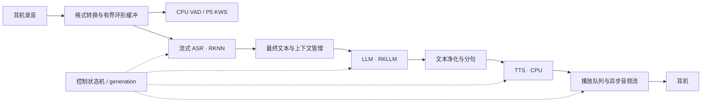

# RK3588 原生语音引擎执行计划

版本：1.2 · 更新日期：2026-10-16（Asia/Shanghai）  
当前阶段：**基础开发依赖已安装且版本查询通过；vivo TWS 4 设备参数与默认录放设置已确认；蓝牙连接及同时录放基线已完成。C++17/依赖编译链接检查已通过；板端 Git 初始化和忽略规则已完成；GitHub 私有仓库已创建且首次推送成功。模型推理及应用验收尚未开始。**

本文件是实施入口。环境证据见 [environment.md](docs/environment.md)，验收用例见 [ACCEPTANCE.md](docs/ACCEPTANCE.md)，问题与修订依据见 [PLAN_REVIEW.md](docs/PLAN_REVIEW.md)。[2026-10-14 原计划](docs/archive/EXECUTION_PLAN_2026-10-14.md)仅作历史留存。

## 1. 已确认条件与当前结论

目标：在香橙派 5 上运行离线语音助手，完成“触发 → 听懂 → 本地回答 → 播报”，后续加入唤醒、连续对话与打断。借鉴 voicenpu_engine 的模块划分，自建适配现有系统的工程。

| 条件 | 当前结论 | 证据性质 |
|---|---|---|
| 硬件、系统 | Orange Pi 5 / RK3588S；aarch64；Ubuntu 24.04.1；内核 `6.1.0-1025-rockchip` | 2026-10-16 SSH 实测 |
| 资源 | 总内存约 7.74 GiB，可用约 6.57 GiB；根分区可用约 19.06 GiB；1 GiB swap 当前未用 | 空闲时快照，不能代替模型峰值 |
| NPU | 驱动 `0.9.7`；当前用户可读写对应 `renderD129` | RKLLM 1.3.1 官方手册要求 0.9.8，当前驱动低于要求；需先落实驱动适配 |
| 蓝牙连接、耳机同时录放 | **已完成** | 用户于 2026-10-16 明确确认；无需重做基础验证 |
| 音频服务 | PipeWire / pipewire-pulse 1.0.5 与 WirePlumber 正在运行 | SSH 实测 |
| 耳机设备参数 | vivo TWS 4；mSBC；16 kHz 单声道 S16LE；默认输入输出已设置 | 用户列表及设置确认；完整名称见 environment.md |
| 板端开发条件 | G++ 13.3.0、CMake 3.28.3、Ninja 1.11.1 及基础音频开发库已安装；最小 C++17 编译链接已通过 | 用户终端输出；RKNN/RKLLM runtime 尚未部署验证 |
| 电脑工作方式 | Windows 11 + SSH；约 15.73 GiB RAM；F 盘约 535.57 GiB 空闲 | 用户明确不使用 WSL；沿用现有工作方式 |
| 工程现状 | 审阅前本地仅有规划文档；板端工程目录已创建，env-check-Ca991G 检查通过；板端 main 已初始化；Windows 已创建首次提交并推送 GitHub 私有仓库；按同一历史同步 | 实测 |

继续使用 Ubuntu 24.04、蓝牙耳机、独立 C++17 / CMake。电脑使用现有 Windows + SSH，程序在开发板原生编译；模型优先取得配套预转换产物，**不使用 WSL，不安排其安装**。首期不引入 ROS、容器、摄像头、联网问答、工具调用或声纹识别。模型与词典备齐后，核心对话不依赖网络。中文优先，兼顾数字、日期和少量英文。

初次审阅进行了 SSH 只读检查。之后用户已自行安装基础开发依赖并设置耳机默认录放设备；文档按其输出和确认同步。尚无模型推理、驱动更新或新程序录放测试结果。

## 2. 里程碑与范围

| 里程碑 | 用户可用行为 | 必须通过 | 暂不要求 |
|---|---|---|---|
| M0 技术可行 | 选定的 RKNN 和 RKLLM 组合在本板分别推理成功 | P0-04；版本及模型可追溯 | 完整语音交互 |
| M1 按键 MVP | 通过终端命令开始/结束录音，自动端点，识别后简短回答并播报；随时取消；可清空会话 | P4-02；验收 A01～A10 | 语音唤醒、边播边说 |
| M2 连续对话 | 唤醒进入对话窗口，支持语音打断，避免自身播报反复触发 | P5；A11、A12 | 多人远场、无限距离或复杂噪声环境 |
| M3 可部署版本 | 离线启动、设备恢复、日志限额、可回退、长稳运行 | P7；A13、A14 | ROS 集成和其他产品形态 |

M1 的“按键”先实现为 SSH/本地终端的行命令：`start`、`stop`、`cancel`、`new-session`、`quit`。耳机媒体键和 GPIO 按钮作为后续输入适配，不作为 MVP 前置条件。

验收中的崩溃、串音、无界队列、错误设备选择属于硬性失败。性能数值是本项目的初始目标，P2/P3 用实测提出调整，写明原因并由项目负责人确认后更新；不得在报告中把未达标直接改写为通过。

## 3. 技术方案与兼容性关口

### 3.1 组件选择

| 组件 | 第一实施选择 | 接入约定 |
|---|---|---|
| 录放 | PipeWire 的 PulseAudio 兼容服务 + `libpulse` 异步 API | 一个连接管理事件循环；输入输出分流；禁止在音频回调中推理或写磁盘 |
| 格式与文件 | `libsamplerate` 重采样，`libsndfile` 读写测试 WAV | 测试文件用 16 kHz、单声道、PCM S16LE；内部帧用 float32 并显式标记幅度尺度 |
| VAD | Silero VAD，经 sherpa-onnx / ONNX Runtime 在 CPU 执行 | 和 TTS/KWS 尽量共用一套固定版本的 sherpa-onnx；按模型要求聚帧 |
| ASR | Rockchip Zipformer 中英模型，encoder / decoder / joiner，RKNN FP16 起步 | 同版本 tokens、特征提取参数和缓存形状配套；先复现官方 WAV，再改成增量接口 |
| LLM | Qwen3.5-2B，RKLLM，文本输入，W8A8 起步 | 2048 总上下文、最多 128 输出 tokens；禁用思考模式；不加载视觉编码器 |
| TTS | sherpa-onnx `vits-melo-tts-zh_en`，CPU，单说话人 | 作为第一测试声音；模型、tokens、lexicon、dict、数字/日期 FST 一起收集；输出再适配耳机采样率 |
| KWS | sherpa-onnx 中文小模型，P5 再加载 | 第一候选 `sherpa-onnx-kws-zipformer-wenetspeech-3.3M-2024-01-01`；关键词必须按模型 token 规则编码 |
| 编排 | 单一控制状态机 + 模型工作线程 + 有界队列 | 所有异步事件携带 session/generation/sequence；统一取消与超时 |
| 配置、日志 | yaml-cpp、nlohmann-json，YAML / JSONL | 启动时校验；默认不保存原始录音或完整对话内容 |

TTS 官方资料列出的 163 MB 是单个模型文件，不是完整包或运行内存；其输出为 44.1 kHz，英文发音受词典覆盖影响。只把它当待测候选，不预先保证语速和声音质量。[TTS 模型资料](https://k2-fsa.github.io/sherpa/onnx/tts/pretrained_models/vits.html)

### 3.2 SDK 选择规则

| 路线 | 本轮确认的资料 | 首轮行动 | 禁止提前认定的结论 |
|---|---|---|---|
| Qwen3.5 | RKLLM 1.3.0 起加入支持；1.3.1 手册明确要求 RKNPU 0.9.8 | 先落实当前内核的驱动适配，再使用配套头文件、aarch64 runtime 与模型产物验证 | 当前 0.9.7 不满足手册要求；小模型也不能跳过驱动前置条件 |
| Qwen3 | RKLLM 1.2.1 起加入 Qwen3 支持 | 仅在已验证的 SDK/驱动组合中评估 Qwen3-1.7B | 更小或更旧的模型不自动解决驱动兼容问题 |
| Zipformer | 官方提供 RK3588 FP16 转换与 C++ 文件示例；Model Zoo 2.3.0 引入该例程 | 先评估固定的 Model Zoo / RKNN Toolkit2 / runtime 2.3.2 配套组合；若与所选 RKLLM 库不兼容，再评估成套新版本 | 不把当前 main 例程与任意旧 runtime 混搭 |

依据：[RKLLM 变更记录](https://github.com/airockchip/rknn-llm/blob/main/CHANGELOG.md)、[Model Zoo 版本依赖表](https://github.com/airockchip/rknn_model_zoo#environment-dependencies)。主线会变化，下载时固定 tag/commit 和 SHA-256。上表是候选顺序，不是已经通过的版本锁。

**官方已明确驱动要求。** [瑞芯微 RKLLM SDK 1.3.1 中文手册](https://github.com/airockchip/rknn-llm/blob/main/doc/Rockchip_RKLLM_SDK_CN_1.3.1.pdf)第 12 页 §2.4 要求板端 RKNPU 驱动为 v0.9.8，低于 v0.9.8 时更新；第 13 页说明驱动适配涉及 kernel-5.10 / kernel-6.1，列出参考内核版本。当前实测 `0.9.7` 低于要求，因此问题已从“驱动要求未知”收敛为“落实当前 Ubuntu 内核的驱动更新方案及恢复方法”。这不要求改用其他 Ubuntu 发行版，也不能只替换用户态 `.so` 解决。详见 [兼容性依据](docs/compatibility.md)。

**P0-04 的执行顺序：**

1. 补全 `docs/compatibility.md` 的 runtime/模型配套版本及 GLIBC/GLIBCXX 信息。运行 RKLLM 1.3.1 前先满足官方驱动要求：针对当前 `6.1.0-1025-rockchip` 准备匹配的更新、备份和恢复方法，更新后复查驱动版本；本轮仅记录要求，未执行更新。
2. 取得官方可追溯的预转换小模型及配套 runtime。先验证 Qwen3.5-0.8B 文本推理，再验证目标 2B；0.8B 成功不等于 2B 验收成功。找不到配套产物时先评估其他可追溯的兼容模型；确需自行转换则登记资源缺口和转换需求，不预设或安装新的电脑运行环境。
3. 用配套头文件编译官方最小例程，记录实际加载 `.so` 路径、`sha256sum`、模型元数据及版本日志。禁止拷贝到系统库目录覆盖现有库。
4. 分别运行 LLM 和 Zipformer 官方例程，再用目标 2B 做短文本、中文输出、正常结束、主动取消和重复初始化测试。具体次数见 A03/A04。
5. 通过后把候选改为 verified；再开始依赖该组合的应用适配。文件损坏、ABI 错配、驱动拒绝、内存不足分别归因。

**驱动适配分支：**当前 0.9.7 已知低于 RKLLM 1.3.1 要求，不再通过随机更换模型试探这一已知前置条件。主路线为针对当前内核准备驱动更新、备份及恢复方法；若保持驱动不变，则只能选择另有官方依据且实测通过的旧 SDK/模型组合，并记录目标变化。没有兼容组合就保持 M0 未通过，不隐式更换系统或把 CPU 路线当作 NPU 目标已完成。其余运行问题可按约 1 人日或两组有依据的组合形成决策记录，独立的音频和工程任务可继续。

目标模型默认是 2B；若改选 0.8B 或 Qwen3-1.7B，应更新选型理由和模型清单，并执行同样的完整质量、资源和取消验收，不能仅凭工具链小模型测试通过交付。

ASR 与 LLM 的库可能同时依赖 RKNN 公共符号；即使分别成功，**P2-04 仍必须验证同进程共存和版本加载**。若冲突不可消除，再把 LLM 隔离到有界 IPC 的工作进程，更新架构、内存预算和验收；不能靠随机调整库搜索顺序掩盖问题。

## 4. 实现约定

### 4.1 音频、ASR 与端点

- 系统级蓝牙连接和录放基线已完成。新程序接入时枚举并保存真实 source/sink；排除 monitor，禁止丢失耳机后自动播到 HDMI 或板载扬声器。
- 保持用户验证过的双向 profile；设备名比临时数字 ID 稳定，但也需用设备属性核验。断开或 profile 变化时关闭旧流、清空残帧及重采样状态，再按配置重新匹配。
- 应用传输帧默认 20 ms；VAD 和 ASR 各自累积到模型要求的窗口，不能直接把 20 ms 当作模型输入长度。
- 内部统一单声道 16 kHz float32；VAD 使用归一化尺度，ASR adapter 按所固定例程的幅度、fbank、帧移和填充要求转换，以同一 WAV 对齐结果。麦克风不足 16 kHz 时重采样不恢复带宽。
- ASR 接口至少包含 `reset`、`accept_audio`、`finish_input`、`partial/final`。维护跨帧 fbank、encoder 缓存、decoder 历史和末尾补帧；一轮结束、取消、设备重连时复位。
- VAD 初值：预录 500 ms、最短有效语音 200 ms、末尾静音 600 ms、等待开口最多 5 s、单次发言最多 15 s。无声超时返回等待；达到上限则结束本轮并给出长度限制事件；空识别不请求 LLM。

官方 Zipformer C++ 示例将完整音频先交给特征提取器，再按模型块推理。上述增量改造必须单独完成，不能以 WAV 示例通过代替实时流通过。[官方源码](https://github.com/airockchip/rknn_model_zoo/blob/main/examples/zipformer/cpp/rknpu2/zipformer.cc)

### 4.2 状态、调度与数据边界

主状态：`STARTING → IDLE → LISTENING → FINALIZING → RESPONDING → IDLE`。P5 开启连续对话时，正常播报结束转回带 15 s 等待窗口的 LISTENING，超时再回 IDLE。异常分支为 `CANCELLING`、`DEVICE_WAIT`、`ERROR`、`STOPPING`。`RESPONDING` 内用独立标记表示 LLM、TTS、播放是否活跃，允许三者流水工作，不将“生成中”和“播放中”建成互斥状态。



- M1 默认 ASR 和 LLM **串行占用 NPU**。录音线程始终独立运行，输出期间不自动发起 ASR/KWS 请求；`start` 会取消当前回答再开始新一轮。P5 的 CPU VAD/KWS 先检测用户，再取消 LLM，确认释放 NPU 后启动 ASR。
- 数据结构至少有 `session_id`、`generation_id`、`seq`、单调时钟时间戳；音频还带采样率、声道、样本数，文本带 `partial/final`。ASR partial 仅用于显示，final 才触发 LLM。
- 模型句柄由各自 worker 持有；控制线程发送消息，不跨线程销毁仍在推理的句柄；SDK 回调上下文存活至任务完全结束。
- 首版每模块单 worker，TTS 推理线程初值 2，VAD/KWS 初值 1；按实测控制总线程数，不默认绑核、提实时优先级或锁最高频率。

| 缓冲/队列 | 初始上限 | 满载行为 |
|---|---:|---|
| 采集环形缓冲 | 2 s，预录包含在此范围内 | 采集不阻塞；标记溢出并结束受影响轮次，不把缺帧拼成正常语句 |
| 等待处理的用户轮次 | 1 | 新 `start` 取代旧轮次，执行取消；不排队攒问题 |
| LLM 回调文本 | 8 KiB | 回调不等待 TTS；超限触发本轮受控取消并记录原因 |
| 待合成文本 | 4 段，每段最多 40 个 Unicode 字符 | 上游有界协调；无法限流时受控取消，不静默丢中间句子 |
| 待播放 PCM | 按实际采样率计，最多 2 s | TTS worker 可取消地等待；录音/控制线程不等待 |
| 单次 TTS 临时输出 | 最多 20 s 音频，一次只持有一段 | 分成小帧送入播放队列；超过上限取消并报告 |

### 4.3 取消、播报与连续会话

取消顺序：控制线程先递增 generation → 关闭旧输出入口 → 清空旧文本/PCM 队列 → 请求 LLM abort、取消 TTS → 对播放流 cork/flush → 等待模型结束确认，再允许下一次 NPU 调用。每个回调、队列入口和播放提交点均核对 generation；旧结果即使迟到也不得提交。

`rkllm_abort` 返回不等于回调已经全部结束；按固定版本 API 检查运行状态和结束事件。等待上限初值 2 s，超时进入 ERROR 并交由进程重启策略恢复，不强行释放活动句柄。新语音可先存入 2 s 环形缓冲；若恢复不及导致溢出，报告需重说，不隐瞒丢字。[RKLLM API](https://github.com/airockchip/rknn-llm/blob/main/rkllm-runtime/Linux/librkllm_api/include/rkllm.h)

播放取消使用 flush 丢弃缓冲，正常结束才 drain；两者语义不同。音频服务确认清空不代表蓝牙耳机的硬件缓冲已经静音，因此软件取消时间和实际尾音分开测量。[PulseAudio API](https://github.com/pulseaudio/pulseaudio/blob/master/src/pulse/stream.h)

LLM 输出先做跨 token 的 UTF-8 拼接和控制标记过滤，再分句。按句末标点切分，初值最短 8 字、最长 40 字；等待超过 300 ms 且已有足够文字可提前分段；EOS 时冲刷剩余短句。不要截断 UTF-8 字节、数字小数或未闭合控制标记。TTS 不播报思考内容、特殊 token 或 Markdown 控制符。

会话由应用持有，默认不与 runtime 的隐式历史重复累积。按固定 tokenizer/chat template 计算总 tokens：系统提示 + 历史 + 本轮输入 + 128 输出预算 + 64 余量 ≤ 2048；超限按完整轮次淘汰最旧历史，单条输入仍过长则拒绝并提示缩短。模板只能应用一次。结束/取消后按已验证 API 清理 KV 状态；仅把完整正常完成且播报结束的问答对加入历史，取消轮次不写入。

P5 采用可配置唤醒词，初始开发词为“你好小派”，并验证该词在候选 KWS 模型上可编码。唤醒后开放 15 s 对话等待窗口；播报结束后重新计时；无声超时回到等待唤醒。语音打断初值需持续语音 250 ms，并用 A12 验证。若自身声音误触发，则评估 AEC 的播放参考、时间对齐和延迟漂移；未通过前关闭语音打断，保留按键 MVP，不能宣称 M2 完成。

### 4.4 故障与超时初值

| 情况 | 行为 |
|---|---|
| 缺模型、哈希不符、缺词典、错误设备配置 | 启动校验失败，报告明确文件/配置；不循环下载 |
| ASR 端点后 3 s 无最终结果 | 取消本轮并复位 ASR |
| LLM 10 s 无首 token 或总生成超过 30 s | 发起取消；保留日志和原因 |
| 单段 TTS 10 s 未完成 | 取消该轮；不把失败文本留到下一轮 |
| 设备断开、profile 变化 | 取消本轮，进入 DEVICE_WAIT；按 1/2/5 s 退避发现设备；恢复后等待新触发 |
| 运行时失去响应 | 最多等待取消 2 s；受控退出；部署层在 60 s 内最多重启 3 次 |
| MemAvailable 连续 3 s 低于 1.5 GiB | 拒绝新轮次并取消/释放可回收缓存；不得依赖持续 swap 维持交互 |

## 5. 工作分解、依赖与交付

角色：**实施者**负责开发与客观证据，**用户/项目负责人**负责声音体验、答复质量和目标变更确认。所有未标记完成的任务均为待执行；文件名和命令接口是交付约定，不表示工具已经存在。

| ID | 任务与主要动作 | 依赖 | 交付与完成条件 | 状态 |
|---|---|---|---|---|
| B00 | 盘点板端、电脑及项目现状 | 无 | `docs/environment.md` 与检查证据 | 已完成 |
| B01 | 蓝牙连接与耳机同时录放基线 | 无 | 用户确认通过，不再要求重复基础测试 | 已完成（用户确认） |
| P0-01 | 初始化 Git；忽略模型/构建/音频/本机配置；安装最小板端开发依赖 | B00 | C++17、CMake、pkg-config 可用；空程序可构建；依赖版本清单 | 已完成：依赖安装/版本查询、C++17 编译链接、板端 Git 初始化/忽略规则（用户输出） |
| P0-02 | 固定 SDK 候选及官方例程版本；落实当前内核的 RKNPU 0.9.8 更新/恢复方案，补全 ABI 要求 | B00 | `docs/compatibility.md`；RKLLM 路线满足官方驱动前置条件后才进入 P0-04 | 待执行（驱动要求已核实） |
| P0-03 | 取得配套的预转换小模型、目标模型和 Zipformer 资源；缺产物时评估兼容候选并记录转换资源需求 | P0-02 | 文件大小/哈希/来源及生成版本齐全；未取得的产物明确标记，不自动新建电脑运行环境 | 待执行 |
| P0-04 | 板端官方最小推理，验证最终选定模型（默认 2B）；处理兼容失败分支 | P0-01～03 | M0 通过；冻结首个 verified 组合；A03/A04 的 SDK 基线部分 | 待执行 |
| P1-01 | CMake 工程、配置校验、JSONL、控制命令、无硬件 mock 边界 | P0-01 | `voice_engine --check-config` 与错误退出码；可独立构建 audio/engine | 待执行 |
| P1-02 | 异步录放、设备绑定、重采样与重连；使用已记录的耳机参数 | P1-01、B01 | `audio_probe`；A01/A02 通过（验收新程序） | 参数采集及系统默认设置已完成；程序开发/验收待执行 |
| P1-03 | 提前准备 20 条固定语音、参考转写、关键词和 LLM/TTS 文本用例 | P1-01 | 版本化 fixture 清单，满足验收文档的样本定义；不依赖实时引擎 | 待执行 |
| P2-01 | VAD / 流式 ASR adapter，缓存复位及 WAV/分块一致性 | P0-04、P1-01、P1-03 | `asr_probe`；A03 全部通过 | 待执行 |
| P2-02 | RKLLM adapter，流式文本、模板、上下文、abort 与超时 | P0-04、P1-01、P1-03 | `llm_probe`；A04/A08 模型侧通过 | 待执行 |
| P2-03 | TTS adapter、中文归一化、分句、播放格式转换 | P0-01、P1-01、P1-03 | `tts_probe`；A05 通过；声音样本供用户听取 | 待执行 |
| P2-04 | 所有 MVP 模型同时驻留、同进程库兼容与顺序 NPU 调度 | P2-01～03 | `coexist_probe`；A06 通过；确定是否需进程隔离 | 待执行 |
| P3-01 | 使用 P1-03 的固定语料验证文件级完整链路 | P2-04、P1-03 | `voice_file_demo`；A07；各段耗时、内存与失败样本可复查 | 待执行 |
| P4-01 | 实时控制状态机、端点、分段播报、有界队列、按键取消 | P1-02、P3-01 | `voice_engine`；正常、无声、超时、取消均有确定状态转移 | 待执行 |
| P4-02 | 20 轮实机交互、延迟批测及异常注入 | P4-01 | A01～A10 均通过，发布 M1；未达性能目标需明确记录 | 待执行 |
| P5-01 | CPU KWS、关键词编码、连续对话窗口 | P4-02 | A11 通过，关键词配置可修改 | 待执行 |
| P5-02 | 语音打断、迟到回调防护、回声误触发测量 | P5-01 | A12 通过；若需 AEC，完成 P6-01 后再验收 M2 | 待执行 |
| P6-01 | 根据报告优化端点/分句/线程/缓冲，必要时实验 AEC 或 NPU 并发 | P4-02；涉及语音打断时依赖 P5-02 初测 | `docs/performance.md`，同样本前后对比；优化后重跑受影响用例 | 待执行 |
| P7-01 | 固定发布目录与库路径、离线资产检查、用户服务及回退 | M1；发布 M2 时还需 P5 通过 | `docs/deployment.md`、启动/回退脚本；A13 通过 | 待执行 |
| P7-02 | 1 小时长稳、无桌面登录启动、退出登录/重启及设备恢复验收 | P7-01 | A14 通过，发布 M3，标注所含功能是 M1 还是 M2 | 待执行 |

P1 音频、P2-03 CPU TTS 可在 NPU 兼容调查期间独立推进。P2-04 必须在整条链路开发前完成。首次交付 M1 不必等待 P5/P6。

按 1 名实施者初估：P0 2～4 人日，P1 2～3，P2 4～6，P3 1～2，P4 3～4，P5 3～5，P6 2～4，P7 1～2；总计 **18～30 人日**，其中 M1 工作量约 **12～19 人日**。不含模型大文件下载等待、硬件等待和内核/驱动升级专项。P0/P2 结束后依据结果重估，不给未经验证的日历承诺。

## 6. 验收入口与执行证据

完整矩阵在 [ACCEPTANCE.md](docs/ACCEPTANCE.md)。首个发布的核心要求：固定语音语料至少 18/20 条关键词全部正确；20 轮实机对话全部完成；无旧 generation 播报、无无界队列、无 OOM；模型共驻时维持 1.5 GiB 内存余量目标。

延迟同时报告“用户最后一个语音采样点 → 耳机实际首音频”和“VAD 判定端点 → 首音频”，前者包含端点等待。预热短回答的前者 P95 初始目标为 ≤5 s。接口首音频提交不等于实际听见，后者必须用外部录音测量或标明仅估算，不能混成同一指标。

每次验证保存到 `output/runs/<run_id>/`：`run.json`（代码/配置/模型版本、环境、用例）、`metrics.jsonl`、`summary.json`、失败样本 ID；调试 WAV 按需开启且受配额限制。状态为 `passed / failed / blocked / not_run`，只有真实通过才勾选。用户确认的 B01 标为 `user_confirmed`，不伪造时长、采样率和测量日志。

## 7. 工程、资产与依赖管理

电脑工程：`F:\AI\RK3588音频引擎`；板端工程：`/home/jzh/projects/rk3588_voice_engine`。Windows 管理文件并通过 SSH 操作，程序在板端原生编译，模型使用配套预转换产物；板端不安装模型训练环境。

```text
rk3588_voice_engine/
├── EXECUTION_PLAN.md
├── CMakeLists.txt                 # 待 P1 创建
├── src/{audio,asr,llm,tts,engine}/
├── include/
├── config/default.yaml            # 通用默认值
├── config/local.yaml              # 本机设备名/路径，Git 忽略
├── scripts/                       # 构建、检查、启动、回退
├── docs/                          # 规划、环境、兼容性、部署、验收
├── tests/{fixtures,unit,integration}/
├── models/manifest.json           # 提交清单，不提交权重
├── models/                        # 本机模型和词典
├── deps/manifest.json             # SDK/源码/库版本及许可证
├── deps/                          # 固定版本运行库，按组合分目录
├── build/                         # Git 忽略
└── output/                        # 日志/测试结果，受配额限制
```

配置字段必须在 P1 定义类型、单位、范围和缺省值，至少覆盖：设备 source/sink/profile、采样率/帧长、VAD 时间参数、模型路径、线程数、2048/128 token 限额、队列容量、各段超时、日志配额、唤醒和语音打断开关。设备名或必需模型未填写时失败退出；禁用 KWS 时不要求下载 KWS 模型。`--check-config` 仅校验配置和资产，不打开录音。

每个模型资产记录：`id`、官方来源 URL、原始 revision、许可证、目标平台、量化类型、toolkit/runtime 版本、转换命令和校准数据来源/哈希、全部关联文件的路径/字节数/SHA-256、输入输出/采样率/词表约定、实测峰值内存、`candidate/verified` 状态和对应 run_id。预转换模型也必须说明生成版本；来源不明的模型不作为发布资产。

依赖清单同时锁定 runtime、C/C++ 头文件、sherpa-onnx、ONNX Runtime 和模型词典。板端使用程序相对 RPATH 或启动脚本的私有库路径，记录实际加载路径，禁止只换 `.so` 不换配套头文件/产物。

板端首批普通依赖候选：`build-essential cmake ninja-build pkg-config libpulse-dev pulseaudio-utils libsamplerate0-dev libsndfile1-dev libyaml-cpp-dev nlohmann-json3-dev`。安装前模拟并核对空间；`pulseaudio-utils` 用于查询现有兼容服务，不额外启用 PulseAudio 服务。ASR 的 fbank 等依赖跟随固定例程登记。上述基础依赖已由用户安装，工具和主要库版本查询已通过；最小 C++17 编译链接检查也已通过（ENV_CHECK_OK）。

模型准备采用“Windows 下载与校验 → SSH/SCP 传输 → 板端检查和推理”。必须同时取得生成版本、目标 `rk3588`、量化方式和配套运行库。若选定模型只有原始权重或 ONNX，先记录缺少的转换产物并核对是否有配套预转换版本；仍无法取得时，将转换作为独立待解决任务，明确需要的 SDK、输入输出和资源，再确定实施地点。当前计划不假设存在其他 Linux 主机，也不安排安装 WSL、虚拟机或容器；该产物未解决时仅阻塞依赖它的任务，音频与 CPU TTS 仍可推进。

## 8. 资源、部署与回退

### 8.1 资源控制

| 项目 | 板端新增空间预算 |
|---|---:|
| 开发依赖与源码 | 0.3～1.0 GiB |
| ASR/VAD/KWS 与语音 SDK | 0.5～1.5 GiB |
| 一份 Qwen3.5-2B 及 runtime | 1.8～3.5 GiB |
| 一份 TTS 与语言资产 | 0.2～0.8 GiB |
| 编译产物 | 0.5～1.5 GiB |
| 下载、解压、发布暂存 | 0.5～3.5 GiB |
| 日志及人工保存的音频 | 最多 0.5 GiB |

表内上限合计约 12.3 GiB，属未由实际模型验证的预算；额外一份完整旧模型未包含。每次下载/转换/发布前按实际文件大小计算同时存在的模型、压缩包、解压目录和回退文件；操作后预计空闲低于 3 GiB 则停止新增文件。候选权重优先留电脑；清理先列路径与用途，不删除当前模型和回退所需文件。

不能将模型磁盘大小当作运行内存：P2-04 同时采集总 RSS/PSS（可取到时）、MemAvailable、swap 变化及 NPU 分配相关指标。系统监测采样周期 1 s；记录 CPU/NPU 频率与温度，确认降频是否造成后半程延迟恶化。

日志按文件轮转，JSONL 初值单文件 10 MiB、最多 10 份；其余人工音频共享总 500 MiB 额度，达限停止新增音频。常态不记录录音、完整 prompt/回答和私有连接凭据。

### 8.2 部署与恢复

初期以 `jzh` 普通用户交互运行；部署优先使用 `systemd --user`，连接该用户的 PipeWire/Pulse socket。当前 `Linger=no` 且用户不在 render 组，当前 NPU 可访问可能依赖登录会话 ACL；P7 必须验证无桌面登录/退出登录后的音频与 NPU 权限，不以当前 SSH 成功替代。

发布包包含可执行文件、私有运行库、默认配置、模型清单和许可证；安装布局使用版本目录及 `current` 指向，模型按哈希共享。先校验文件、执行 smoke，再切换版本。回退须恢复代码、配置和兼容的模型/runtime 组合；若更换模型需保留旧权重，先按实际大小核算空间。内核/驱动回退另属专项，不能用应用回退代替。

核心程序不启动远程 API 服务。离线验收限制应用外网访问或断开外网，保留管理用 SSH 局域网；验收必须覆盖重启后的冷启动、中文前端词典和 tokenizer，防止首次运行暗中下载。

## 9. 下一次实施的首批动作

1. 继续 P0-01：基础依赖无需重装；C++17 与音频/YAML/JSON 库的最小编译链接检查已通过，板端 Git 初始化和忽略规则也已完成，GitHub 私有仓库首个提交已推送，Windows 与板端按同一历史同步；接着进行 CMake/Ninja 工程构建。
2. 执行 P0-02：官方已明确 RKLLM 1.3.1 要求 RKNPU 0.9.8，先针对当前 Ubuntu 内核落实匹配的驱动更新和恢复方案，再补全候选版本矩阵，不先全量下载所有模型。
3. 执行 P0-03/04，取得一套配套小模型/runtime，跑通最小推理，再验证目标 2B 和 Zipformer。失败按 §3.2 形成可执行分支。
4. 同期可进行 P1-01 和 CPU TTS 的资源整理；使用已记录的 vivo TWS 4 设备名称完成 P1-02 的程序验收。B01 保持已完成。
5. M0 通过后进入 P2 adapters 与同进程共驻验证，再实现文件链路和实时 MVP。

## 10. 资料与证据边界

本轮核对日期为 2026-10-16。上文链接支持框架/接口选择，板端可用性仍以实际运行记录为准。

- [RKLLM 官方仓库](https://github.com/airockchip/rknn-llm)：RK3588 系列及 Qwen 支持、官方预转换模型入口。
- [Zipformer 官方例程](https://github.com/airockchip/rknn_model_zoo/tree/main/examples/zipformer)：三模型转换、FP16 起步及 Linux C++ 验证。
- [Qwen3.5-2B 官方模型](https://huggingface.co/Qwen/Qwen3.5-2B)：模型及非思考模式；在 RKLLM 上仍需验证模板和文本链路。
- [sherpa-onnx KWS](https://k2-fsa.github.io/sherpa/onnx/kws/index.html)：候选模型及关键词编码。
- [参考项目 voicenpu_engine](https://gitee.com/bravexyz/voicenpu_engine)：沿用原规划的架构参考定位；本轮未能读取仓库内容，未据此宣称其实现已审计。

RKLLM 1.3.1 的驱动要求已由官方手册确认；尚待落实本板驱动更新方式、RKNN 所选版本要求、实际模型哈希、应用音频缓冲及性能数据。这些均已分配到明确任务，官方前置条件满足后仍需执行模型和应用验收。


