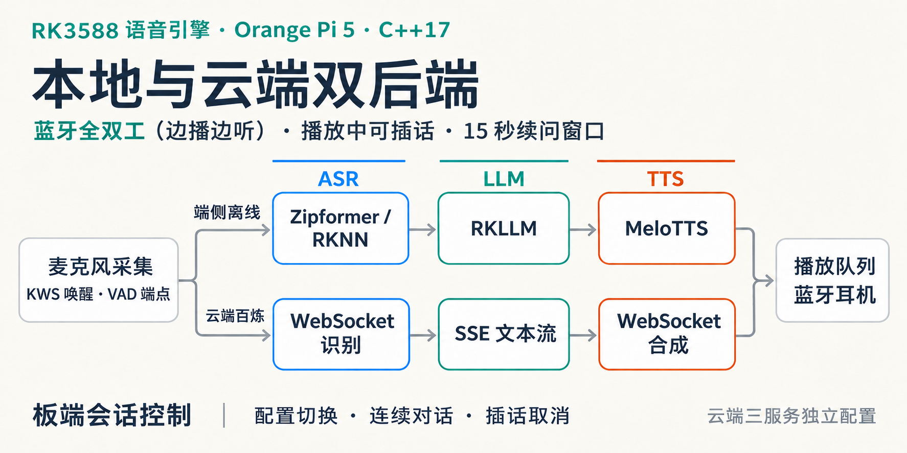

# RK3588 语音助手

在香橙派5上完成“听懂问题 → 生成回答 → 耳机播报”的C++17语音引擎，支持蓝牙耳机双向录放与播放中插话（全双工）。双后端构建可选择由板端离线完成识别、回答和合成，或调用百炼服务。



## 首次安装与版本

当前源码版本为 **v0.3.0**，新增阿里云百炼语音链路。源码包和校验文件通过 [GitHub Releases](https://github.com/jzh03/rk3588_voice_engine/releases) 提供。云端构建、百炼配置和切换方法见[云端语音指南](docs/cloud-voice.md)。

1. 按[支持的平台与系统依赖](docs/supported-platform.md)确认 Orange Pi 5 / RK3588S、Ubuntu 22.04.5、内核 6.1.99 和 RKNPU 0.9.8 组合，并安装开发与音频依赖。
2. 端侧安装按[资产获取与首次运行](docs/assets-setup.md)准备模型、运行库和本机音频配置。云端或双后端安装按[云端语音指南](docs/cloud-voice.md)选择构建方式、准备所需资产并配置凭据。
3. 查阅[版本变更](CHANGELOG.md)、[v0.3.0 发布说明](docs/releases/v0.3.0.md)和[发布约定](docs/releases.md)。

支持范围以已验证组合为准；其他板卡、内核、运行库组合需独立验证。安装和模型准备需要联网，端侧模式在资产齐备后可离线交互。

<a id="当前进度"></a>

## 能做什么

- 说“你好小派”唤醒，提问并听取回答。
- 回答结束后有15秒连续对话窗口，无声超时后重新等待唤醒。
- 播报时直接插话（全双工：播放中持续采集），停止旧回答并接续新问题。
- 支持取消、清空会话、耳机断线恢复、本地部署、版本回退和进程异常恢复。

## 日常使用

以下用于已经准备好模型、依赖、本机配置和已安装服务的开发板。先连接耳机，再通过现有SSH入口进入板端：

```powershell
ssh orangepi5
```

在板端工程根目录执行：

```bash
systemctl --user start rk3588-voice-engine
systemctl --user status rk3588-voice-engine
python3 scripts/deploy.py status
```

等待资产检查和模型加载完成后，说“你好小派”，停约2秒，再提问。对话窗口内可继续提问；播放中插话不需要重复唤醒词。

```bash
# 取消当前回答
python3 scripts/deploy.py send cancel

# 用完后停止
systemctl --user stop rk3588-voice-engine
```

服务按需手动启停。双后端版本的[换档与共用语速](docs/cloud-voice.md#部署切换与共用语速)使用同一个用户服务。配置、CLI 和通用部署命令见[构建与运行](docs/build-and-run.md)。

## 性能快照

2026-10-27 · Orange Pi 5 / RK3588S · 发布 `p7-m2-20261027-r2`。

| 验证项目 | 结果 |
|---|---|
| 自动化连续对话 | 10/10轮完成 |
| 耳机重连：空闲、录音、播放各1次 | 3/3项通过 |
| 重连后的响应样例：空闲 / 录音 / 播放 | 2.276 / 2.717 / 2.209秒 |

响应时间从识别结束计到音频后端接受首帧回答，采用软件时间戳。三条样例均提问“请说一句欢迎回来”；TTS为4线程、语速0.85。完整参数、计时口径和离线复算命令见[快照说明](docs/performance-snapshot.md)，数值对应[精简证据](docs/evidence/performance-snapshot-20261027.json)。

### 云端流式链路实测

2026-11-06 · Orange Pi 5 / RK3588S · 百炼流式链路 · 蓝牙耳机真人交互。

| 指标 | 结果 |
|---|---|
| 同一会话内完整回答 | 10 轮 |
| 播放中主动插话 | 2 次，旧回答取消后均完成新回答 |
| VAD 端点至首帧提交 | 中位数 1.720 秒，范围 1.381～2.291 秒（10 个完成轮） |
| 板端采集空洞、队列溢出、丢事件、播放欠载 | 记录计数均为 0 |

这组数据取自一次唤醒后的会话片段，计时使用板端软件事件。历史端侧快照从 ASR 完成计时，起点与本组不同。测量条件和每轮时间见[云端性能快照](docs/cloud-performance-snapshot-20261106.md)。

## 文档入口

| 内容 | 入口 |
|---|---|
| 支持的平台、系统及依赖安装 | [支持矩阵与依赖](docs/supported-platform.md) |
| 模型、运行库获取与首次配置 | [资产获取与首次运行](docs/assets-setup.md) |
| 版本、正式发布与回退 | [版本变更](CHANGELOG.md)、[发布入口](docs/releases.md) |
| 编译、配置、CLI与资产清单 | [构建与运行](docs/build-and-run.md) |
| 百炼和兼容服务配置、流式 ASR/TTS 与双后端部署 | [云端语音指南](docs/cloud-voice.md) |
| 耳机录放与设备排查 | [音频诊断](docs/audio-diagnostics.md) |
| 性能快照、参数与证据复算 | [快照说明](docs/performance-snapshot.md) |
| 公开文档和工具入口 | [文档索引](docs/README.md) |

模型权重与运行库按[资产准备说明](docs/assets-setup.md)获取，身份由[模型清单](models/manifest.json)和[依赖清单](deps/manifest.json)固定；仓库提供固定合成输入和相应工具。

## 项目目录

```text
src/、include/       引擎实现与接口，云端协议适配位于 src/cloud/
tools/               独立诊断工具
config/              配置模板；本机配置不随Git发布
scripts/、packaging/  部署脚本与用户服务模板
tests/               回归代码与固定合成输入
models/、deps/        资产身份清单；权重与运行库实体不随Git发布
docs/                使用说明、性能快照与官方参考资料
output/              本机运行记录，不随Git发布
```

## 开发与旧章节入口

| 章节 | 位置 |
|---|---|
| <a id="基础环境检查"></a>基础环境检查 | [构建与依赖](docs/build-and-run.md#基础环境检查) |
| <a id="配置检查"></a>配置检查 | [配置字段](docs/build-and-run.md#配置检查) |
| <a id="资产清单"></a>资产清单 | [资产规则](docs/build-and-run.md#资产清单) |
| <a id="终端控制与-jsonl-日志"></a>终端控制与JSONL日志 | [控制入口](docs/build-and-run.md#终端控制与-jsonl-日志) |
| <a id="模型文件诊断"></a>模型文件诊断 | [文件工具](docs/build-and-run.md#模型文件诊断) |
| <a id="真实音频诊断"></a>真实音频诊断 | [耳机排查](docs/audio-diagnostics.md#真实音频诊断) |
| <a id="版本管理约定"></a>版本管理约定 | [版本管理](docs/build-and-run.md#版本管理约定) |

## 许可证

项目自有代码和文档采用 [MIT License](LICENSE)，Copyright (c) 2026 jzh03。第三方代码、模型和运行库保留各自许可，详见[第三方来源与许可](THIRD_PARTY_NOTICES.md)。源码发布不捆绑模型、运行库、本机配置或私人录音。
