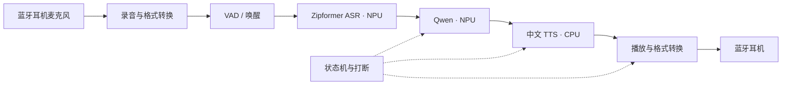

# RK3588 原生语音引擎执行计划

日期：2026-10-14  
状态：计划已整理，安装和开发尚未开始。开发板已由用户断开，后续执行前再连接。

## 1. 已确认的目标与条件

目标是在香橙派 5 上实现本地语音助手，借鉴 voicenpu_engine 的模块划分和调度思路，自建适配当前系统的工程。

用户已确认：

- 使用现有 Ubuntu 24.04，不要求照搬参考项目的 Ubuntu 22.04 / ROS 2 Humble 环境。
- 使用蓝牙耳机；已自行验证可以同时播放音频和录音。
- 大模型考虑新版 Qwen。
- 当前只生成执行计划，不继续连接开发板。

根据此前建议，本计划默认采用独立 C++17 程序和 CMake，首期不引入 ROS 或容器；若以后需要机器人节点通信，再增加 ROS 2 Jazzy 接口。

最近一次板端核对结果：

| 项目 | 已知信息 |
|---|---|
| 开发板 | 香橙派 5，RK3588 系列，aarch64 |
| 系统 | Ubuntu 24.04.1 LTS |
| 内核 | `6.1.0-1025-rockchip` |
| 内存 | 约 8 GB |
| RKNPU 驱动 | `0.9.7` |
| 可用磁盘 | 约 20.52 GB，即 19.1 GiB |
| SSH | `ssh orangepi5`，目标 `192.168.137.2`，用户 `jzh` |
| 下载代理 | `http://192.168.137.1:17897`，转发到电脑代理 |
| 音频 | 蓝牙耳机同时录放已由用户验证；设备名、profile、采样率和实际音频服务待执行时记录 |

这些是环境快照，不代表所有模型与 SDK 已经过兼容性测试。模型和 SDK 精确版本将在最小推理验证后固定。

## 2. 实现范围与模块选择

首个可用版本支持“触发录音 → 识别 → 本地回答 → 语音播报”。随后加入唤醒词、连续对话和打断。模型全部下载完成后，核心对话链路应能离线运行。

| 模块 | 首选方案 | 执行要点 |
|---|---|---|
| 蓝牙录放 | PulseAudio 兼容 API / `libpulse` | 先确定当前音频服务是 PulseAudio 还是 PipeWire 的兼容服务；显式指定耳机 sink/source |
| 音频格式 | 内部 ASR 输入统一为 16 kHz、单声道 PCM | 对实际蓝牙录音格式做转换；播放格式按当前耳机 profile 协商结果处理 |
| VAD | Silero VAD，CPU 推理 | 以轻量运行库执行，避免在板端安装模型训练环境 |
| ASR | 中文/英文流式 Zipformer，RKNN | 采用官方 RK3588 转换路径，先验证 encoder、decoder、joiner 三个模型 |
| LLM | Qwen3.5-2B，RKLLM，使用文本对话链路 | 优先验证受支持的量化格式；具体转换和运行库版本由驱动兼容测试决定 |
| TTS | sherpa-onnx 中文 VITS，CPU 推理 | 先选择一个声音模型；记录首音频延迟与生成速度，再决定是否需要 NPU TTS |
| 唤醒词 | sherpa-onnx KWS，CPU 推理 | 在基础链路通过后加入；仅加载一套所需模型 |
| 编排与打断 | C++ 状态机、有限队列、会话 generation ID | 取消旧回答、停止继续提交旧 PCM，防止新旧对话串音 |
| 配置与指标 | YAML 配置、JSONL 指标 | 模型路径、音频设备、上下文长度、队列大小均可配置 |

RKNN 与 RKLLM 模型转换在电脑的兼容 Linux 环境中完成，优先评估已有 Linux / WSL2 环境。板端保留必要的运行库、转换后模型和程序。电脑转换环境的磁盘及内存需求另行核算。

### 新版 Qwen 的选择顺序

1. **主选：Qwen3.5-2B。** 作为回答质量与资源占用的初始折中，先执行纯文本推理验证。
2. **轻量候选：Qwen3.5-0.8B。** 可借官方 RK3588 样例验证工具链，或在 2B 延迟/内存不满足目标时评估。
3. **兼容候选：Qwen3-1.7B。** 如果 Qwen3.5 所需 SDK 与现有驱动不兼容，则评估这一新版系列候选，而不是直接假定旧驱动能运行 Qwen3.5。

默认只保留一份用于正常运行的大模型。候选模型的测试结果保留在电脑，避免板端长期存放多份权重。

Rockchip 官方主线资料列出了 Qwen3.5 支持及 RK3588 的 W8A8 示例，但这不能证明当前 `0.9.7` 驱动已经兼容，也不能证明所有尺寸都支持 W4A16。本计划按较保守的 W8A8 空间预算，最小验证通过后再确定量化方式。参见 [RKLLM 官方说明](https://github.com/airockchip/rknn-llm)。

初始上下文长度目标为 2048 tokens，单次回答先限制为 64～128 tokens。如模型和模板支持，优先评估非思考模式；TTS 仅播报最终回答，不直接播报控制标记或推理内容。

## 3. 蓝牙音频设计

以用户已经测试成功的同时录放配置为起点，先记录该配置，再开发应用。不能仅根据板载 ALSA 声卡列表判断蓝牙设备是否可用。

执行时需要记录：音频服务名称、耳机设备标识、活动 profile、输入 source、输出 sink、编码方式、采样率、声道数及缓冲延迟。

- 沿用已验证可同时录放的 profile，不自动切换到可能关闭麦克风的播放配置。
- 以稳定的设备名称绑定输入和输出，不依赖临时声卡序号。
- 明确选择耳机麦克风输入，排除播放设备的 monitor source。
- 若麦克风原始采样率低于 16 kHz，重采样只能满足模型输入格式，不能恢复已损失的频率信息；识别质量需要实测。
- 蓝牙断开、重连或 profile 变化后重新打开音频流，并复位分帧/重采样状态。
- 先实现按键触发与按键打断，再加入语音唤醒和语音打断。
- AEC 不作为第一版的前置依赖。若实测存在播放漏入麦克风、自唤醒或打断误判，再增加回声消除并测量蓝牙录放延迟。



## 4. 执行阶段与验收条件

每阶段先完成产物和验证，再进入下一阶段。以下目录和程序名是拟定产物，目前尚未创建。

| 阶段 | 主要工作 | 交付物 | 通过条件 |
|---|---|---|---|
| P0 环境与兼容确认 | 重新连接后记录蓝牙工作配置；确认 NPU 访问权限、驱动/runtime/toolkit 兼容组合；检查电脑转换环境 | `docs/environment.md`、版本与空间清单 | 同时录放稳定；选定一组可验证的 SDK；不以未经核对的最新版替换运行库 |
| P1 音频与工程骨架 | 建立 C++17/CMake 工程、配置、日志和蓝牙录放封装；完成重采样、分帧及设备重连 | `audio_probe`、基础配置、录放记录 | 耳机同时录放至少 10 分钟，无持续溢出、阻塞或意外 profile 切换；重连可恢复 |
| P2 模型分别验证 | 按需取得 ASR/VAD/TTS；在电脑转换并校验 RK3588 模型；运行 Qwen 最小文本推理 | `asr_probe`、`llm_probe`、`tts_probe`、`models/manifest.json` | 三项分别产生有效结果；无驱动错误/OOM；模型与运行库来源、版本和哈希已记录 |
| P3 文件级完整链路 | 用测试 WAV 串联 ASR → LLM → TTS，测量各段耗时 | `voice_file_demo`、测试样本与结果 | 至少 20 条固定语音样本可完成整条链路，输出内容与输入对应，没有旧回答混入 |
| P4 实时 MVP | 接入耳机麦克风，支持触发录音、端点检测、回答、分段合成和播报；控制队列长度 | `voice_engine` MVP、端到端指标 | 连续 20 轮交互完成；播放不阻塞录音线程；回答及播放队列不会无限增长 |
| P5 唤醒与打断 | 加入 KWS、会话状态与 generation ID；实现取消生成、丢弃旧 TTS、停止旧播放；实测语音打断 | 连续对话版本、打断测试记录 | 唤醒后进入对话；打断后下一轮不播报上一轮残留；记录蓝牙缓冲导致的实际尾音 |
| P6 并发与延迟优化 | 验证 ASR/LLM 的 NPU 竞争、TTS 分段、蓝牙缓冲和 CPU 占用；有实测需要时加入 AEC | 调度配置、性能报告 | 高负载时录音不中断；自身播报不造成反复唤醒；各项延迟有可重复测量结果 |
| P7 部署与回归 | 整理启动脚本、依赖与模型清单、故障恢复和日志限额；验证断网与设备重连 | 部署说明、回归清单、可选 systemd 服务 | 核心链路断网仍可运行；至少 1 小时运行无崩溃和持续内存增长；蓝牙重连后可继续交互 |

P0/P2 是兼容性关口。若 Qwen3.5 所需运行库无法在当前驱动运行，先记录具体最低要求，再比较匹配版本、候选模型或驱动升级方案。内核/驱动升级单独评估，不混入普通依赖安装。

P4 是第一个可用里程碑；P5/P6 才完成连续对话、语音打断及必要的音频优化。项目无需等到全部高级功能完成才能试用。

### 指标记录与初始目标

以下为工程目标，不是对当前硬件性能的保证；P2/P3 实测后调整并固定。

- 建立 20 条中文测试语音，覆盖常用问答、数字和少量英文；记录 CER 和关键词正确率，初始关键词正确目标为至少 18/20。
- 分别记录：语音端点到文本、LLM 首 token、TTS 首音频、语音端点到实际听见回答。
- 区分首次加载与模型预热后的结果，统计中位数和 P95，不能只记录最快一次。
- 短回答的预热端到端首音频先以 P95 不高于 5 秒为试用目标，后续根据真实瓶颈调整。
- 分别测量“软件停止提交 PCM”和“耳机实际停止发声”的时间，避免忽略蓝牙已缓冲的尾音。
- 连续交互期间保持至少 1.5 GiB 的 `MemAvailable` 作为初始内存余量目标；同时检查 NPU 缓冲和 swap 使用。
- 初期沿用常规线程调度，依据实测决定是否需要 CPU 分配或实时优先级调整。

## 5. 目录与版本管理

电脑工程目录：`F:\AI\RK3588音频引擎`。拟定板端目录：`/home/jzh/projects/rk3588_voice_engine`。

```text
rk3588_voice_engine/
├── CMakeLists.txt
├── src/
│   ├── audio/          # 蓝牙录放、重采样、分帧
│   ├── asr/            # VAD、Zipformer、唤醒接口
│   ├── llm/            # RKLLM 对话与流式输出
│   ├── tts/            # 中文合成与分段
│   └── engine/         # 状态机、队列、打断
├── config/
├── scripts/
├── docs/
├── tests/              # 固定语音、模型探针与集成回归
├── models/manifest.json
├── models/             # 权重不放入 Git
├── deps/               # 项目所需运行库及许可证
├── build/
└── output/             # 有限日志和人工保存的测试音频
```

版本清单记录 SDK/toolkit/runtime、模型名称及量化方式、目标 `rk3588`、文件大小、SHA-256、下载来源和转换参数。运行库使用项目独立目录加载，便于回退和避免与其他程序混用。

第一版只下载所需例程和模型，保留固定版本的源码/模型清单；不批量下载整个模型库。默认不长期保存连续录音，调试样本按需保存。

## 6. 空间预算与控制

采用新版 Qwen3.5-2B，并以 W8A8 而非未经验证的 W4A16 预算后，板端新增峰值暂按 **6～10 GiB** 规划。当前约有 19.1 GiB 可用，仍有余量。

| 项目 | 初步板端预算 |
|---|---:|
| 必要开发依赖与项目源码 | 0.3～1.0 GiB |
| ASR、VAD、KWS 模型与语音 SDK | 0.5～1.5 GiB |
| Qwen3.5-2B 转换后模型与运行库 | 1.8～3.5 GiB |
| 一个中文 TTS 模型 | 0.2～0.8 GiB |
| 编译产物及部署文件 | 1.0～2.0 GiB |
| 下载、解压和临时缓存 | 0.5～1.2 GiB |

预算尚未由实际模型文件大小验证；重复拷贝、不同量化格式和 SDK 构建方式都会改变峰值。参考仓库原本的模型路径不能直接当作本机已具备的资源。

- 下载前获取文件大小；记录下载与解压共存时的峰值。
- 模型转换、中间权重和完整训练依赖放在电脑端，未计入上表。
- 板端长期保留一套已验证模型及必要运行库；测试其他候选时先核算空间。
- 为系统保留至少 3 GiB 空闲；预计跌破该值时暂停新增下载和大规模构建。
- 日志和人工保存的音频先合计预算 500 MiB，达到上限后停止增加调试文件并提示处理。
- 整理缓存前列出路径与用途；当前使用的模型、源码、配置和应用状态不作为垃圾删除。

## 7. 执行前仍需确定的信息

这些项目不妨碍计划成立，但必须在相应阶段落实：

| 待确认项 | 确认阶段 | 对方案的影响 |
|---|---|---|
| 蓝牙耳机实际 profile、输入输出名称、采样率与延迟 | P0/P1 | 决定设备绑定、重采样、缓冲和打断效果 |
| 当前音频服务及麦克风真实输入 source | P0 | 决定 C++ 录放接入方式 |
| 驱动 0.9.7 对应的 RKNN/RKLLM 兼容版本 | P0/P2 | 决定 Qwen3.5 是否可以保持当前内核直接运行 |
| Qwen3.5-2B 的实际转换可用性、量化格式和内存占用 | P2 | 决定主模型或轻量/兼容候选 |
| 电脑 Linux 转换环境、可用空间和内存 | P0 | 决定在本机、WSL2 或其他已有 Linux 环境转换 |
| 中文 TTS 声音及模型文件大小 | P2 | 决定声音质量、生成速度和额外占用 |

初步顺序为：**环境与音频 → 最小 NPU 推理 → 模型分别验证 → 文件链路 → 实时 MVP → 唤醒/打断 → 优化和部署**。P0/P2 通过后再给出更可靠的工期，避免把驱动或模型转换的不确定性藏进开发时间。

## 8. 资料依据

- [参考项目 voicenpu_engine](https://gitee.com/bravexyz/voicenpu_engine)：借鉴语音模块划分、状态调度和打断思路。
- [Rockchip Zipformer RKNN 例程](https://github.com/airockchip/rknn_model_zoo/tree/main/examples/zipformer)：列出 RK3588 支持及按目标平台转换方法。
- [Rockchip RKLLM](https://github.com/airockchip/rknn-llm)：说明电脑转换、板端 C/C++ runtime，以及 Qwen 系列和 RK3588 支持。
- [Qwen3.5-2B 官方模型](https://huggingface.co/Qwen/Qwen3.5-2B)：主选模型；当前工程只计划接入文本对话链路。
- [Qwen3.5-0.8B 官方模型](https://huggingface.co/Qwen/Qwen3.5-0.8B)：轻量候选。
- [Qwen3-1.7B 官方模型](https://huggingface.co/Qwen/Qwen3-1.7B)：兼容性候选，仍需最小推理验证。
- [sherpa-onnx](https://github.com/k2-fsa/sherpa-onnx) 与 [VITS TTS 模型资料](https://k2-fsa.github.io/sherpa/onnx/tts/pretrained_models/vits.html)：语音运行接口与中文 TTS 候选来源。
- [ROS 2 Jazzy 的 Ubuntu 安装资料](https://github.com/ros2/ros2_documentation/blob/jazzy/source/Installation/Ubuntu-Install-Debs.rst)：以后需要 ROS 接口时使用 Ubuntu 24.04 原生路径。

官方资料说明支持的平台和框架；蓝牙设备与驱动版本来自本次沟通及已完成核对。所列空间、延迟和内存目标为规划值，实施时以实测结果更新。
